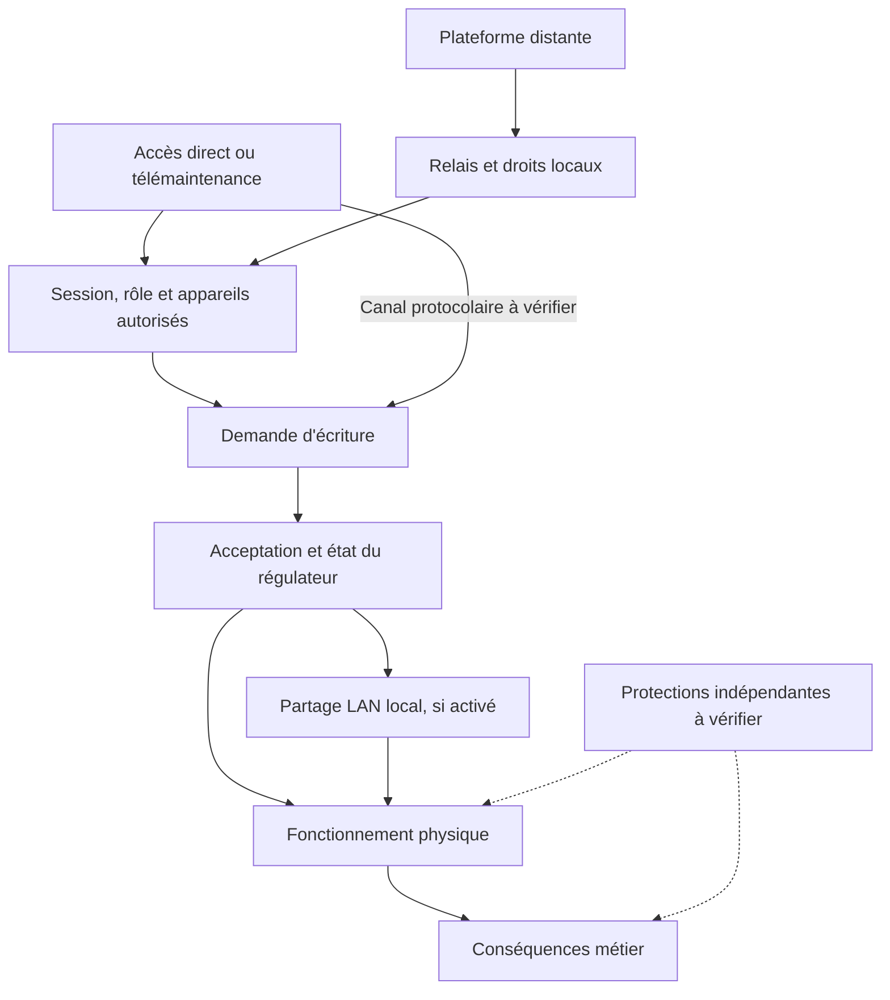

# Danfoss / XWEB : qui peut agir sur une installation frigorifique ?

**Investigation indépendante sur les accès, les droits de modification et la reprise des installations frigorifiques**

**v1.1 — Actualisation du 22 octobre 2026 (publication initiale : 18 octobre 2026)**  
**Auteur (pseudonyme) :** lxrider. **Textes originaux :** [CC BY 4.0](LICENSE.md).  
[English version](STUDY.en.md) · [Accueil](README.md) · [Corrections](CORRECTIONS.md)

En octobre 2026, des perturbations frigorifiques sont signalées dans le commerce alimentaire. Pour un magasin, une perte de maîtrise du froid menace la conservation des produits, peut interrompre l'activité et mobilise les équipes de maintenance dans l'urgence. Comprendre ces incidents demande de répondre à trois questions : **comment les équipements étaient-ils accessibles, qui pouvait modifier leur fonctionnement et pourquoi certaines installations ont-elles été affectées tandis que d'autres étaient épargnées ?**

Le CERT-FR signale de nombreuses compromissions de contrôleurs à distance Danfoss AK-SM/AK-SC et Copeland/Dixell XWEB. Son alerte a été publiée le 12 octobre, étendue à d'autres équipements le 13, puis révisée le 16 pour mettre à jour les recommandations. Elle établit le périmètre des familles signalées et les mesures préconisées ; elle ne détermine pas le vecteur initial.[1](#ref-1)

Cette étude examine les installations frigorifiques des grandes et moyennes surfaces (GMS) alimentaires en France, leur télésurveillance et leur maintenance. Une supervision relie des accès numériques à des fonctions physiques : réguler, dégivrer, détecter une dérive et permettre une intervention. Nous avons rapproché les observations de surface Internet, les témoignages et la documentation produit pour reconstruire les autorités capables d'agir sur ces fonctions. Dans le vocabulaire métier, cette supervision peut relever de la gestion technique centralisée (GTC) du froid, sans constituer nécessairement une GTB couvrant tous les lots techniques du bâtiment. Aucun test actif n'a été effectué sur une installation tierce.

## Résultats et question ouverte

Notre investigation fait ressortir quatre constats principaux :

- **Les accès distants dépendent de plusieurs acteurs.** Les témoignages recueillis montrent que les responsabilités de configuration, d'administration et de sécurisation peuvent être réparties entre exploitants, DSI et prestataires. Ces pratiques sont **REPORTED** ; leur rôle dans les compromissions reste **UNKNOWN**.
- **Des perturbations similaires ne prouvent pas un même chemin d'attaque.** Les technologies Danfoss et XWEB disposent de fonctions d'administration différentes (**DOCUMENTED**). Aucun vecteur commun n'a été établi.
- **Les modifications apparentes sur XWEB présentent une cohérence fonctionnelle.** La photographie examinée montre des séries de changements visant notamment les consignes, leurs limites, le dégivrage et certains paramètres d'alarme (**OBSERVED**). La comparaison de sept bibliothèques constructeur renforce la compréhension technique de ces paramètres. Une configuration préparée est plausible, mais l'outil employé, les connaissances de l'opérateur et son intention restent **UNKNOWN**.
- **Une commande enregistrée ne prouve pas sa bonne exécution.** Les fonctions de préparation, d'écriture et de lecture sont distinctes (**DOCUMENTED**). Nous ne disposons pas des éléments permettant de confirmer l'acceptation de chaque modification par le régulateur ou ses conséquences physiques.

### Une limite configurable est-elle une véritable protection ?

Sur certaines familles de régulateurs Dixell, la consigne de température (`SEt`) est encadrée par une limite supérieure configurable (`US`).

Cette limite peut normalement empêcher certaines consignes hors plage. Mais **si une même identité possède les droits nécessaires pour modifier à la fois la consigne et sa limite, celle-ci ne constitue pas une protection indépendante contre les actions de cette identité**.

Le journal XWEB présente des écritures apparentes concernant ces deux paramètres. Il ne démontre toutefois ni que les modifications ont été acceptées, ni qu'une même identité disposait effectivement de tous les droits nécessaires.

Les autres protections doivent être examinées séparément : peuvent-elles encore agir si la supervision ou le régulateur est compromis ? Protègent-elles les équipements, la continuité du froid, les denrées ou seulement la détection des anomalies ?

**La question décisive demeure l'origine de la première écriture anormale acceptée.** Les hypothèses H1–H5 restent **INDETERMINATE** et les scénarios COA-A/B/C demeurent ouverts, sans classement. Les étiquettes probatoires sont définies dans la section « Méthode, provenance et reproductibilité ».

## 1. Quatre constats issus de l'enquête

### A. L'accès distant résulte aussi de décisions d'organisation

Le questionnaire technique a recueilli **43 participations**, dont **42 retenues pour l'exploitation technique** dans le dossier de recherche. Un questionnaire distinct sur les accès réseau et leur gouvernance a recueilli **25 participations** dans l'instantané du 17 octobre. Les unités comptées sont des réponses. Le recouvrement entre participants et la présence de plusieurs installations dans certaines réponses empêchent d'en déduire un nombre de personnes indépendantes ou de magasins.

| Déclaration dans l'enquête de gouvernance | Réponses sur 25 |
|---|---:|
| Responsabilités de sécurisation jugées souvent floues | 17 |
| Application des règles du client sans pouvoir imposer les siennes | 14 |
| Aucune règle clairement définie connue | 8 |
| Accès Internet direct cité parmi les pratiques habituelles | 18 |
| Prise en main distante d'un poste froid | 11 |
| VPN cité | 7 |

Ces catégories se recouvrent. Elles décrivent des pratiques et perceptions **REPORTED** dans un échantillon volontaire, dont la représentativité reste **UNKNOWN**. La réconciliation interne des exports établit que les 24 réponses de l'instantané antérieur ont été conservées et qu'une réponse a été ajoutée : les anciens chiffres 24/16 et les chiffres 25/17 correspondent à deux états de collecte, sans correction rétroactive des déclarations.

Des réponses libres décrivent des moyens d'accès demandés par le client, fournis par son informatique ou laissés à la charge du mainteneur, y compris des connexions cellulaires. D'autres évoquent la difficulté d'obtenir un accès adapté au besoin de surveillance. **Une connexion 4G ne renseigne, à elle seule, ni son adressage, ni son filtrage, ni l'existence d'un VPN.** Ces témoignages montrent une répartition possible des décisions ; ils n'établissent pas l'architecture d'une victime ni la cause de sa compromission.

Un témoignage direct, distinct des questionnaires, décrit un accès fourni par l'exploitant et parfois partagé avec d'autres usages (**REPORTED**). La segmentation et les communications latérales restent **UNKNOWN**. Le partage d'un boîtier d'accès peut recouvrir des segments isolés ou un réseau commun ; le dossier ne départage pas ces configurations.

L'exploitant, l'enseigne, la DSI, le frigoriste, le prestataire réseau, l'intégrateur et l'astreinte peuvent ainsi détenir chacun une partie des moyens d'action. Le lien peut être fourni par un acteur, les comptes administrés par un autre, les réglages modifiés par un troisième et les alarmes reçues ailleurs. Nous ne disposons pas d'entretiens directs documentés avec des directions d'enseignes, des DSI de GMS ou des responsables de magasins. Les contrats, les pouvoirs de décision et les responsabilités effectives restent à établir.

Cette lecture de la *supply chain* porte sur la **délégation des accès, de la maintenance et des décisions de reprise**. Une intrusion chez un prestataire ou une altération logicielle demeurent des hypothèses distinctes. Le CERT-FR demande aussi de vérifier les conditions d'assurance avant d'interrompre la remontée des données vers le frigoriste.[1](#ref-1) Le confinement doit intégrer la continuité des alarmes, l'astreinte et le service dégradé.

### B. Des conséquences comparables ne désignent pas un vecteur commun

Les récits Danfoss et la pièce XWEB décrivent des contextes distincts. Ils ne forment pas une chronologie forensique unique. Des consignes, dégivrages ou alarmes peuvent être modifiés dans plusieurs écosystèmes sans que le même accès, la même vulnérabilité ou le même acteur soit en cause.

| Famille ou génération | Distinction technique utile | Ce qui reste à établir pour les incidents |
|---|---|---|
| **Danfoss AK-SM 800/850 historiques** | Les permissions dépendent du profil et de la fonction. Le niveau Supervisor requis pour un tunnel de maintenance particulier ne s'étend pas automatiquement à toute commande Web. | Modèle, configuration, rôle et canal réellement utilisés. |
| **Danfoss AK-SM 800A** | Le *Session Control* et l'activation de ST-500 sont deux réglages séparés. Le bulletin R4.3.1 annonce ST-500 désactivé par défaut, avec réactivation possible pour la maintenance. | État historique de ces contrôles ; absence de transposition aux générations antérieures. |
| **XWEB historique / Classic** | Bibliothèques d'instruments `.xw5`, distinctes de la version de l'application et du firmware du régulateur. | Bibliothèque effectivement chargée et famille du système photographié. |
| **XWEB EVO** | Préparation, import dans la table applicative, sélection des paramètres et *Write* vers un ou plusieurs instruments sont des étapes distinctes. | Permissions effectives, validation et résultat de chaque opération. |
| **XWEB PRO** | Le manuel distingue les permissions et documente une passerelle Modbus TCP/IP désactivable, en lecture seule ou en lecture-écriture, avec liste de contrôle réseau optionnelle. | Activation et contrôle de ce canal alternatif ; fonctions PRO non présumées dans EVO. |

Ces capacités sont **DOCUMENTED** pour les produits et révisions cités.[6](#ref-6)[8a](#ref-8a)[8b](#ref-8b)[8c](#ref-8c)[17](#ref-17) Leur présence et leur utilisation sur les installations affectées restent **UNKNOWN**. Les vulnérabilités publiées par Claroty concernent des générations identifiées ; leur exploitation pendant les incidents d'octobre n'est pas établie.[5](#ref-5)

La comparaison affecté/épargné apporte surtout une limite à l'interprétation. **22 répondants** au questionnaire technique déclarent avoir rencontré à la fois des installations touchées et épargnées. Parmi ces 22 réponses, les différences cochées sont les suivantes, avec choix multiples :

| Différence déclarée | Répondants sur 22 |
|---|---:|
| Modèle ou version du superviseur | 14 |
| Mode d'accès distant | 10 |
| Configuration réseau ou filtrage | 8 |
| Configuration des comptes de maintenance | 5 |
| Aucune différence identifiée | 4 |

Seuls **deux** de ces répondants renseignent un firmware ; un seul de ces deux coche aussi « modèle ou version ». Le dossier ne contient donc ni quatorze comparaisons de firmware vérifiées, ni vingt-deux paires de magasins contrôlées. Un accès public déclaré sans modification constatée contredit une lecture automatique « exposition donc compromission », sans démontrer une protection efficace ni une tentative hostile. Des différences perçues restent **REPORTED**, sans valeur causale mesurée.

### C. Les modifications apparentes rendent plausible une préparation fonctionnelle

La pièce XWEB est une photographie de journal visible dans une capture reçue d'une publication présentée comme publique sur un réseau professionnel. La page d'origine, les circonstances de collecte et l'authenticité de la trace industrielle restent **UNKNOWN**. **OBSERVED** qualifie uniquement le contenu visible consulté.

La relecture consignée relève **39 lignes apparentes d'écriture**, réparties en **trois séries de treize** concernant trois régulateurs, avec les mêmes couples code/cible. Un groupe partiel concerne un autre régulateur. La publication conserve le motif analytique ; elle exclut la photographie, sa transcription, les valeurs initiales et cibles, les horodatages détaillés, les identifiants et le lien vers la publication d'origine.

Le rapprochement documentaire porte sur les catégories suivantes :

| Catégorie | Lecture de la pièce | Appui constructeur | Limite |
|---|---|---|---|
| Consignes | Demandes apparentes visant des réglages de consigne | Consigne et modes de fonctionnement décrits par famille | État accepté et mode actif inconnus |
| Limites applicatives | Une borne de plage est aussi visée | Bornes configurables de la consigne | Droit effectif de modifier consigne et borne à établir |
| Dégivrage | Plusieurs réglages compatibles avec cette fonction | Déclenchement, durée et sondes dépendent du modèle | Aucun cycle effectif ni effet thermique déduit |
| Alarmes | Seuils ou délais apparemment visés | Dictionnaires et fonctions variables suivant les générations | Réduction effective de la détection non établie |

**Comparaison statique des bibliothèques XM679K.** L'examen hors ligne de sept fichiers officiels du catalogue XWEB historique, reproduit lors du contrôle du 18 octobre, recherche les codes comme entrées exactes du dictionnaire de paramètres (`P`). Les sept empreintes SHA-256 concordent avec celles conservées lors de l'analyse. Aucun installateur constructeur n'a été exécuté.[17](#ref-17)

| Version de bibliothèque historique | Identifiant constructeur du fichier XM679K | Codes examinés présents | `ddA` / `FAd` | `rA2` / `A2d` |
|---|---|---:|---|---|
| v0.9 | `003200090000` | 13/13 | Présents | Absents |
| v1.3 | `0032000D0001` | 13/13 | Présents | Absents |
| v3.4 | `003200220012` | 13/13 | Présents | Absents |
| v3.9 | `003200270018` | 13/13 | Présents | Absents |
| v4.2 | `0032002A001D` | 13/13 | Présents | Absents |
| v4.3 | `0032002B001E` | 13/13 | Présents | Absents |
| v5.4 | `003200360029` | 11/13 | Absents | Présents |

Le résultat **OBSERVED** invalide l'objection selon laquelle les treize codes ne pourraient appartenir à une même bibliothèque XM679K : six dictionnaires anciens les contiennent. À l'inverse, le dictionnaire historique v5.4 examiné ne contient pas `ddA` et `FAd`. Cela limite l'hypothèse d'une utilisation de ce dictionnaire précis, sans traduction ni modification ; cela n'identifie ni le firmware des régulateurs photographiés ni leurs bibliothèques réelles.

Les tableaux du manuel XM670K/XM679K de 2015 associent `ddA` au délai d'alarme de la sonde de dégivrage et `FAd` à celui de la sonde ventilateur. Certains libellés de la prose sont moins cohérents que les tableaux. Le manuel XM669K/XM679K v5.4d de 2022 présente un autre ensemble, comprenant `rA2` et `A2d`, sans les deux codes précédents dans le document consulté.[7a](#ref-7a)[7b](#ref-7b) Cette évolution documentaire interdit d'appliquer indistinctement la sémantique d'une génération à une autre.

La frontière de format compte également : les fichiers `.xw5` historiques, les paquets de bibliothèques EVO, la version XWEB et le firmware du régulateur sont quatre objets différents. Le manuel EVO exclut le chargement direct des fichiers Classic. Les paquets EVO n'ont pas été décodés en un dictionnaire sémantique fiable dans cette enquête ; les résultats `.xw5` ne leur sont pas transposés.[6](#ref-6)[17](#ref-17)

**Interprétation de posture adverse.** Si le journal correspond à des actions hostiles réelles et si la sémantique est celle d'une famille compatible, le choix conjoint de consignes, de bornes et de réglages d'alarme rend plausible une préparation visant le fonctionnement frigorifique (**HYPOTHESIS**). Une connaissance préalable du métier constitue une explication possible. Les outils natifs, une configuration préparée par un autre acteur, un apprentissage progressif ou des actions distinctes constituent des explications concurrentes. Le dossier ne permet pas de déterminer les connaissances de l'auteur ni son intention.

Un *Write* natif peut envoyer des paramètres préparés vers plusieurs appareils compatibles. La répétition locale est donc compatible avec une préparation humaine suivie d'un transfert groupé, des opérations successives ou une automatisation externe. Les deux imports ZIP visibles sont signalés en erreur et interviennent après la première série ; ils ne peuvent être présentés comme l'import réussi qui l'aurait déclenchée. Une activité de composant de planification local ne prouve pas une tâche hostile.[6](#ref-6)

Il faut distinguer **préparation des cibles, préparation des valeurs, émission locale et coordination entre établissements**. Aucun de ces niveaux ne démontre automatiquement les suivants.

### D. La commande affichée, l'état actif et l'effet physique sont distincts

Dans le manuel EVO, **Import** charge des valeurs dans le tableau de travail ; **Write** les transfère aux instruments sélectionnés ; **Read** interroge les instruments. Les valeurs invalides sont signalées ; une valeur rouge bloque l'écriture native telle que documentée. Le journal des actions significatives ne spécifie toutefois pas, dans les passages consultés, ce que garantit chaque ligne pour un paramètre et un instrument.[6](#ref-6)

| Étape | Vérification nécessaire | État pour la pièce XWEB |
|---|---|---|
| Permission | Rôle, appareil, fonction et canal réellement autorisés | **UNKNOWN** |
| Préparation | Bibliothèque, valeurs et validation applicative | Fonctions **DOCUMENTED**, état incident **UNKNOWN** |
| Émission | Demande réellement transmise et résultat par instrument | Lignes apparentes **OBSERVED**, transmission **UNKNOWN** |
| Acceptation | Acquittement pertinent et résultat de validation du régulateur | **UNKNOWN** |
| État actif | Relecture, mémorisation et mode de régulation effectif | **UNKNOWN** |
| Effet physique | Mesures indépendantes, état des sorties, sondes et actionneurs | **UNKNOWN** |
| Alerte et protection | Détection, transmission de l'alarme et action de barrières indépendantes | **UNKNOWN** |

Les autorisations *Read Parameters*, *Edit Parameters Value*, *Parameters Visibility Level*, *Import Parameters* et *Send Commands* couvrent des fonctions différentes. Les catégories de visibilité `Pr1`, `Pr2` et `N.V.` d'une bibliothèque ne suffisent pas à établir une permission Web ou protocolaire. Un nom de rôle affiché dans un journal n'identifie pas une personne. La passerelle Modbus TCP documentée pour PRO demande son propre examen de configuration et de contrôle, distinct des rôles de l'interface Web.[6](#ref-6)

Les règles constructeur fournissent des contre-épreuves utiles :

| Mécanisme | Contrainte documentée ou observée dans une bibliothèque | Conséquence pour l'interprétation |
|---|---|---|
| `US` / `SEt` | La consigne est bornée par `LS` et `US` ; certaines règles de `US` se réfèrent aussi à la consigne. | Une borne configurable exige une revue d'autorité ; l'ordre affiché des lignes ne prouve ni l'ordre des trames ni celui des validations. |
| `ALC` / `ALU` | Dans les familles examinées, la plage Celsius relative est 0–50 ; la plage absolue dépend notamment de `ALL` et peut aller jusqu'à 150 °C. | Une valeur admissible dans un mode peut être invalide dans l'autre ; mode, unité, bibliothèque et firmware réels restent inconnus. |
| `CCS` / `rSE` | Une consigne de cycle continu suppose ce mode actif ; la consigne effective peut intégrer d'autres fonctions. | Une consigne affichée n'est ni la consigne active universelle ni une température mesurée. |
| Dégivrage et sondes | Déclenchement par horloge ou intervalle, sondes présentes/configurées et défauts influencent le cycle ; `MdF` peut borner une durée ou servir de durée suivant la configuration. | Aucun cycle ni délai physique précis ne découle des seuls paramètres affichés. |
| Délais et seuils d'alarme | Sémantique, capteur et activation dépendent de la génération. | Une modification d'alarme ne démontre ni sa suppression ni la neutralisation de toutes les protections. |

Ces contraintes sont **DOCUMENTED** par famille ou **OBSERVED** dans les dictionnaires historiques, sans preuve d'application aux appareils photographiés.[7](#ref-7)[7a](#ref-7a)[7b](#ref-7b)[17](#ref-17) Restent possibles une demande groupée acceptée, une acceptation partielle, un rejet, une trace de l'interface seulement, une autre bibliothèque ou un autre canal. La compatibilité d'une valeur avec une plage logicielle ne vaut pas acquittement du régulateur.

Le constructeur précise aussi que l'instrument XM669K/XM679K couvert par le manuel v5.4d ne doit pas être utilisé comme dispositif de sécurité.[7b](#ref-7b) Pour qualifier une protection d'indépendante, trois vérifications sont nécessaires : **l'autorité** qui pourrait la modifier ou la désactiver ; **la capacité physique et fonctionnelle** à agir malgré la perturbation ; **l'objectif protégé**, qu'il s'agisse du matériel, de la continuité du froid, des denrées ou de la détection. Une sécurité de pression peut préserver un compresseur sans préserver les produits. L'état des protections sur les installations affectées reste **UNKNOWN**.

## 2. Reconstituer les chemins depuis la posture de l'adversaire

### De la surface observable aux droits utilisables

L'analyse part d'un adversaire hypothétique dont l'accès, les connaissances initiales et l'intention sont **UNKNOWN**. Elle cherche les informations qu'il pourrait obtenir, les frontières qu'il devrait franchir, les fonctions accessibles et les conditions nécessaires à une conséquence inacceptable. Les démarches effectivement conduites sont ASM/EASM, Attack Path Analysis, Adversary Posture et analyse fonctionnelle des conséquences.

ONYPHE, Censys et SecurityScorecard/Driftnet ont publié des mesures reposant sur des signatures, périodes et unités différentes.[2](#ref-2)[3](#ref-3)[4](#ref-4) Notre enquête les distingue de ses consultations d'archives passives et de ses contrôles hors ligne.

Censys rapporte **1 825 hôtes StoreView français le 11 octobre, puis 537 le 14**. Cette réduction de visibilité indexée ne mesure pas le nombre de magasins assainis. La collecte Driftnet du 13 octobre rapporte **5 282 observations StoreView IP/port, sur 4 642 IP**, et **6 340 observations XWEB IP/port** dans ses populations. Ces résultats sont **REPORTED**, selon les méthodes des auteurs ; ils ne sont ni fusionnés avec nos mesures ni convertis en victimes.[3](#ref-3)[4](#ref-4)

| Relevé Netlas conservé dans le corpus | StoreView | XWEB | Unité et limite |
|---|---:|---:|---|
| Index libellé 10 septembre 2026 | 2 080 | 2 215 | Documents de réponses, dans le périmètre des requêtes archivées |
| Index libellé 29 septembre, réponses filtrées avant le 11 octobre | 1 716 | 1 825 | Documents ; fenêtres recouvrantes, sans série homogène ni décompte de victimes |

Ces chiffres **OBSERVED** au niveau de l'index ne s'additionnent pas. Une date d'index, l'horodatage d'une réponse, la date d'export et le début d'un incident sont des repères distincts. Le réaudit de cinq exports StoreView déjà archivés porte sur **100 enregistrements**, dont l'union contient **87 services distincts** au sens IP/port/protocole. Les doublons entre exports interdisent d'en faire cent équipements indépendants ou une estimation nationale.

Un lot XWEB séparé comporte **20 réponses**, sur **19 IP** et **20 services** : **14** titres `XWEB EVO`, **6** titres `XWEB`, **19** URI HTTP et **1** HTTPS. Ses réponses sont horodatées du **3 au 10 octobre**, bien que l'index soit libellé **29 septembre**. Le titre générique `XWEB` apparaît aussi avec un certificat portant un nom XWEB PRO. Ce contre-exemple invalide une classification automatique « titre générique donc génération ancienne » ; il ne certifie pas le modèle de l'appareil.

Les contrôles hors ligne de signatures et de relations vérifient la cohérence des artefacts examinés. Ils ne mesurent pas la précision des empreintes sur un parc physiquement identifié. Une interface, un favicon, un certificat, une ressource JavaScript ou une cooccurrence d'IP ne prouvent ni firmware, ni propriété, ni relation d'autorité. Les décomptes des moteurs, des services, des régulateurs et des magasins restent séparés.

L'EASM établit ainsi une découvrabilité historique générique. Le passage à un chemin d'incident exige l'exposition historique d'une victime, une frontière effectivement franchie, puis une identité, des permissions et une commande reliées à cette installation.

### Six chemins candidats et propagation locale

Le diagramme représente des **frontières candidates à vérifier**. Chaque flèche demande une preuve propre au produit et à l'installation ; le canal protocolaire n'hérite pas automatiquement des contrôles Web.

| Chemin | Frontières à examiner | Condition décisive sur une installation affectée |
|---|---|---|
| **AP-01 · Web Danfoss** | Interface StoreView, session, permissions de supervision, régulateurs | Accessibilité historique et provenance de la première écriture |
| **AP-02 · Web XWEB** | Génération, authentification, profil, édition et transfert ; canal alternatif selon produit | Droits effectifs et écriture acceptée ; contrôle distinct des autres plans d'accès |
| **AP-03 · Danfoss Service Tool** | Canal de maintenance, service activé, authentification, tunnel vers AK-PC | Configuration et session réellement utilisées |
| **AP-04 · Danfoss Alsense** | Identité, périmètre de gestion, fonctions de modification et System Managers | Droit d'écriture commun à plusieurs sites affectés et événement corrélé |
| **AP-05 · Copeland Connect+ / XWEB** | Autorisations de plateforme, relais de session, droits natifs XWEB | Présence du relais et permissions établies aux deux niveaux |
| **AP-06 · Poste de maintenance** | Téléassistance ou accès au poste local, session de supervision, commande | Provenance d'une première écriture rattachée à ce canal |

Les capacités constructeur sont **DOCUMENTED** pour les produits décrits ; les usages de poste froid sont aussi **REPORTED**. Le tunnel AK-SM vers AK-PC décrit par Danfoss requiert le niveau Supervisor dans le cas documenté. Alsense présente des fonctions de réplication de réglages sur une flotte ; Connect+ documente un relais *Terminal Mode* pour XWEB. Les autorisations de plateforme, de relais et d'application locale demeurent distinctes.[8a](#ref-8a)[8d](#ref-8d)[9](#ref-9) L'implication de chaque chemin dans les incidents reste **HYPOTHESIS**.

La portée locale demande une couche supplémentaire. La documentation XM669K/XM679K v5.4d décrit un réseau de **jusqu'à huit sections**, avec synchronisation optionnelle des consignes (`LSP`), du début de dégivrage (`LMd`) et de sa fin (`dEM`). Elle décrit aussi l'administration locale/MultiMaster et la consigne effective `rSE`.[7b](#ref-7b) Ces fonctions peuvent élargir les conséquences au sein d'une installation lorsqu'elles sont activées ; elles ne prouvent ni des écritures distinctes sur chaque section ni leur journalisation dans XWEB. Leur activation pendant les incidents est **UNKNOWN**.

Cette propagation complète AP-01 à AP-06 sans créer un septième accès initial. Il faut distinguer **plusieurs régulateurs d'une installation, plusieurs superviseurs et plusieurs établissements**. Pour soutenir une autorité multisite effectivement utilisée, trois faits doivent être établis séparément : connectivité à plusieurs sites, droits d'écriture utilisables sur ces sites et événement commun corrélé à au moins deux sites affectés. Le même prestataire, un outil commun ou des réglages similaires ne suffisent pas.

### H1–H5 et COA-A/B/C : accès et séquencement

L'analyse des hypothèses est **structurée et inspirée des principes ACH** : chercher les incompatibilités, les explications concurrentes et les observations discriminantes. Elle ne revendique pas l'exécution intégrale d'une procédure formelle.[16](#ref-16)

| Hypothèse | Proposition à examiner | Élément réellement discriminant |
|---|---|---|
| **H1** | Reconnaissance et compromissions distribuées | Sessions et premières écritures attribuables site par site |
| **H2** | Faiblesse d'authentification ou de configuration récurrente | Même mécanisme applicable et utilisé dans une famille et une configuration vérifiées |
| **H3** | Accès ou renseignements issus de la maintenance | Session reliée à l'écriture, ou preuve distincte d'une sélection par information non publique |
| **H4** | Identité ou plateforme multisite compromise | Droit effectif et événement commun corrélés sur au moins deux sites affectés |
| **H5** | Altération de la distribution logicielle | Artefact altéré, déploiement antérieur aux effets et comportement associé |

**H1–H5 : INDETERMINATE.** Certaines hypothèses peuvent se combiner. H3 distingue l'utilisation d'un accès et celle de renseignements de maintenance. Aucun artefact logiciel altéré ni usage d'une CVE n'est établi dans le corpus d'incident.

**Actualisation institutionnelle du 21 octobre 2026.** Selon les comptes rendus de l'audition de Vincent Strubel, directeur général de l'ANSSI, devant une commission du Sénat, l'analyse communiquée par l'agence ne retient pas l'exploitation des vulnérabilités rendues publiques par des chercheurs durant les deux années précédentes. Elle met plutôt en avant des défauts de sécurisation élémentaires : interfaces d'administration directement exposées à Internet, administration insuffisamment protégée et mots de passe faibles.[18](#ref-18) Cette appréciation **REPORTED** par la presse est une information institutionnelle nouvelle sur le mécanisme général envisagé, **pas** une trace forensique accessible dans notre corpus. Elle renforce la pertinence des configurations et de l'authentification dans l'examen de H1/H2, sans établir une compromission distribuée, un mécanisme unique, une identité intersites ou l'exclusion exhaustive de toute autre voie. Les premières sessions et écritures restent **UNKNOWN** ; H1–H5 ne sont pas classées.

Les scénarios de séquencement posent une autre question :

| Scénario | Lecture candidate | Preuve manquante |
|---|---|---|
| **COA-A** | Préparation d'opérations pour plusieurs familles de produits | Traces de préparation et opérations comparables, datées sur des victimes indépendantes |
| **COA-B** | Adaptation successive après un premier épisode | Chronologie alignée et indices d'apprentissage entre épisodes |
| **COA-C** | Opérations indépendantes ou imitation | Origines et séquences distinctes corroborées |

Ces trois scénarios restent ouverts. La première écriture acceptée, corrélée à une identité, un chemin et un état physique, serait particulièrement discriminante. Une absence de trace devient exploitable seulement après vérification de la couverture du journal, des horloges, de la rétention et de l'intégrité.

### Qualifier les comportements au niveau permis par les pièces

| Référence MITRE ATT&CK for ICS | Qualification dans ce dossier |
|---|---|
| **T0836 · Modify Parameter** | Compatible avec les événements affichés et les modifications rapportées ; action hostile et acceptation à établir |
| **T0838 · Modify Alarm Settings** | Compatible sous réserve de la sémantique et des versions présentes |
| **T0878 · Alarm Suppression** | **UNKNOWN** : suppression effective d'alarmes non établie |

MITRE apporte ici un vocabulaire de qualification. Pour la défense, *M0800 Authorization Enforcement*, *DET0776* et *DET0777* orientent l'examen des autorisations et de la détection des changements.[13](#ref-13) Leur pertinence opérationnelle dépend des traces disponibles et du fonctionnement du produit.

## 3. Cartographier l'autorité et préparer une reprise fiable

### Qui peut agir, sur quoi et sous quel contrôle ?

La **carte d'autorité numérique sur l'installation** rassemble les fonctions critiques, les droits, leurs délégations, les protections et la récupération. Elle synthétise les résultats du cas et les confronte aux domaines déjà couverts par les guides ANSSI et IEC 62443.[10](#ref-10)[11](#ref-11)

| Question | Vérification attendue | État du corpus |
|---|---|---|
| **Fonction critique** | Conséquences métier, plages et tolérances approuvées | Fonction générale documentée ; conditions d'un site **UNKNOWN** |
| **Accès et identités** | Canaux actifs, sessions, rôles et portée | Capacités documentées ; chemin initial **UNKNOWN** |
| **Droits sur les paramètres** | Lecture, préparation, écriture, commande ; consignes, bornes et alarmes | Question étayée par la pièce et les manuels ; droits du site **UNKNOWN** |
| **Protections indépendantes** | Autorité, fonctionnement et objectif protégé | **UNKNOWN** sur les installations évoquées |
| **Traçabilité** | Demande, transmission, acceptation, état actif et mesure | Chaîne complète **UNKNOWN** |
| **Télémaintenance et astreinte** | Décision, révocation, continuité d'alarme et accès de secours | Difficultés **REPORTED** ; répartition contractuelle **UNKNOWN** |
| **Récupération** | Référence saine, sources de paramètres, validation physique et métier | Transferts documentés ; mécanismes de réapparition **UNKNOWN** |

Le *blast radius* désigne ici la **portée technique de l'autorité** sur les comptes, superviseurs, régulateurs et établissements. La portée opérationnelle dépend des fonctions frigorifiques affectables, des modes et des protections. Les conséquences économiques et métier peuvent comprendre pertes de marchandises, interruption, mobilisation des mainteneurs et perturbations logistiques ; elles exigent une évaluation propre à l'installation. Une autorité techniquement locale peut ainsi avoir des répercussions entre organisations, sans disposer de droits sur leurs systèmes.

Pour chaque canal, il faut établir qui **décide et finance, administre, intervient, vérifie, révoque et garantit le repli**. La chaîne de maintenance peut concentrer une capacité d'action sans plateforme centrale unique. Cette synthèse ne revendique ni méthode nouvelle d'audit ni efficacité comparative mesurée.

Les parties 2-1 et 2-4 d'IEC 62443 situent les responsabilités des exploitants et des prestataires ; les parties 3-2 et 3-3 concernent le risque et les exigences système ; les parties 4-1 et 4-2 traitent du développement et des composants. Ce rapprochement thématique oriente les vérifications. Une évaluation de conformité demanderait les éditions et exigences détaillées applicables.[11](#ref-11) L'annexe A conserve cette séparation entre norme, recommandation ANSSI, qualification MITRE et proposition issue de l'étude.

### Quel état de référence permet la récupération ?

Des témoignages décrivent la réapparition d'anomalies après correction ou isolement (**REPORTED**). Une nouvelle anomalie peut correspondre à une nouvelle écriture distante, à un retransfert, à un forçage, à une programmation locale, à des paramètres restés actifs ou à un effet physique différé. Ces explications demandent des traces distinctes.

La documentation AK-SM 800 décrit **Upload** du régulateur vers la base du superviseur et **Download** de cette base vers les régulateurs.[8c](#ref-8c) Les générations XWEB documentent aussi des fonctions d'import, de transfert et de programmation.[6](#ref-6) Une base ou une sauvegarde non fiabilisée pourrait réintroduire des réglages anormaux ; cette possibilité demeure une **HYPOTHESIS** pour les réapparitions rapportées. Le dossier n'établit pas de mécanisme autonome de réécriture hostile par l'interface Danfoss AK-PI.

Un récit Dixell évoque une configuration de sonde inadaptée ; d'autres récits Danfoss concernent des anomalies réapparues. Ils ne décrivent pas les mêmes installations. Les modes de repli d'une famille Dixell ne peuvent pas expliquer, à eux seuls, un événement Danfoss. De même, un composant de planification actif ne démontre pas un rejeu arbitraire de paramètres.

Une validation de reprise doit identifier la référence approuvée, contrôler le sens des transferts, les programmations et les forçages, puis vérifier les valeurs actives, les alarmes et les mesures physiques pertinentes. L'état du superviseur, celui du régulateur et celui d'une sauvegarde peuvent diverger ; une sauvegarde récente peut déjà contenir une configuration anormale. La remise en service doit être validée par le professionnel qualifié et l'exploitant selon les contraintes du procédé.

Le lien constructeur relatif aux superviseurs XWEB figurant dans l'alerte CERT-FR renvoie à un document Copeland/Dixell daté du 14 octobre 2026, décrit comme remplacé sur le serveur le 18 octobre. Selon un compte rendu de veille corrigé le 19 octobre, les recommandations portent notamment sur la restauration d'une sauvegarde antérieure à l'accès suspect, les comptes et profils, les destinataires et essais d'alarmes, la restauration ou la relecture des paramètres des régulateurs, ainsi que la mesure directe des températures des denrées.[19](#ref-19) **Statut : REPORTED pour le contenu détaillé du bulletin**, dont la version courante n'a pas pu être lue directement lors de cette révision. Une sauvegarde du superviseur ne démontre donc pas, à elle seule, que les réglages de chaque régulateur, les alarmes et les mesures physiques sont revenus à un état fiable. Ces recommandations ne prouvent aucun mécanisme de réinjection hostile lors des incidents.

Trois exercices sur table peuvent commencer cette vérification : consigne et borne modifiées sous la même autorité ; fermeture nocturne d'un accès avec maintien de l'alerte ; réapparition d'une anomalie après correction. Ils peuvent révéler une permission trop large ou une décision impossible à prendre. Aucun essai perturbant une installation en service n'est proposé ici.

## 4. Des questions d'investigation transférables

La démarche peut être utile ailleurs lorsqu'une fonction physique dépend d'une administration numérique, d'intervenants multiples et de protections à vérifier. Il s'agit d'une **HYPOTHESIS de transfert**, sans vulnérabilité démontrée dans les secteurs suivants :

| Environnement candidat | Question transférable |
|---|---|
| Eau et assainissement | Qui peut modifier une consigne de traitement et son contrôle, et quelle mesure indépendante détecte une dérive ? |
| Énergie | Jusqu'où s'étendent les droits de téléconduite, et quelles protections restent opérantes dans ce domaine d'autorité ? |
| GTB/GTC | Qui administre les accès des intégrateurs et quels automatismes ou alarmes restent autonomes ? |
| Chaîne du froid pharmaceutique | Quelle source de mesure et quelle procédure permettent de qualifier la conservation et la reprise ? |
| Automatisation agricole | Quelles commandes et synchronisations locales peuvent élargir l'effet d'un accès de maintenance ? |

Ces questions servent à chercher les frontières, les preuves et les contre-exemples. L'exposition, la maturité et le risque de ces secteurs n'ont pas été mesurés. Aucun pilote ni gain comparatif d'audit n'est établi.

## 5. Limites et éléments susceptibles de modifier l'analyse

Le corpus permet une analyse d'architecture et de scénarios, avec une couverture insuffisante pour reconstituer une chaîne forensique complète chez une victime. Les lacunes déterminantes restent :

- la provenance de la première session et de la première écriture anormale acceptée ;
- les modèles, firmwares, bibliothèques et permissions réellement utilisés ;
- des mesures physiques indépendantes reliées aux actions visibles ;
- des paires affecté/épargné comparables et contrôlées ;
- les décisions d'accès et contrats recueillis directement auprès des exploitants, enseignes et DSI ;
- une autorité d'écriture et un événement commun vérifiés sur plusieurs établissements ;
- une preuve d'altération logicielle, de persistance hostile ou d'attribution.

Les questionnaires sont volontaires et déclaratifs. Les archives d'exposition portent sur des objets d'index, sans lien établi avec les victimes. La photographie et les témoignages ont une provenance documentée à l'échelle de leur consultation ; l'authenticité industrielle reste **UNKNOWN**. Les documents internes partagent leurs sources et n'apportent pas de corroborations indépendantes supplémentaires. La revue contradictoire du 18 octobre est une contre-lecture interne conduite avec le même assistant, sans validation par un expert extérieur.

Un journal natif de référence pourrait préciser ce que signifie une ligne d'écriture ; un refus documenté pourrait invalider une interprétation de paramètre ; une matrice de droits pourrait établir une séparation d'autorité ; une protection indépendante pourrait limiter les effets ; une relecture horodatée pourrait distinguer nouvel ordre et comportement différé. Une démonstration autorisée établirait une faisabilité, dont l'utilisation pendant l'incident resterait à prouver.

Le comportement visible, le mécanisme technique, l'effet mesuré, l'intention et l'attribution demeurent cinq questions distinctes. Les lacunes du dossier ne sont ni des preuves d'absence ni des invitations à choisir le scénario le plus convaincant.

## 6. Une étude ouverte à la contradiction technique

Cette v1.1 est une étude indépendante, proposée à la critique des professionnels du froid, de l'OT et de l'Offensive Security. Trois questions restent prioritaires :

| Question | Contre-épreuve utile |
|---|---|
| **Que journalise exactement une écriture XWEB ?** | Référence constructeur ou essai autorisé reliant action, lignes du journal, erreurs, acquittement pertinent et relecture, avec produit et version. |
| **Quelles sont les limites d'autorité réelles sur les régulateurs ?** | Matrice rôles/fonctions/canaux et règles de validation sur une génération identifiée, y compris administration locale et passerelles alternatives. |
| **Quelles protections préservent le procédé lorsque la supervision est compromise ?** | Description assainie d'une barrière : autorité distincte, fonctionnement physique et objectif métier réellement protégé. |

Les contradictions documentées, corrections techniques et résultats d'essais autorisés sont bienvenus. Une contribution utile distingue capacité produit, expérience de terrain, essai de faisabilité et fait d'incident ; elle indique ce qui ferait changer l'interprétation. Les données sensibles, configurations de tiers et journaux bruts restent hors des issues et pièces jointes. La contribution doit respecter les contraintes des équipes en remédiation. Les modalités figurent dans [CORRECTIONS.md](CORRECTIONS.md).

## Méthode, provenance et reproductibilité

**Classification.** **OBSERVED** : contenu directement reçu ou examiné, sans authentifier l'événement sous-jacent. **REPORTED** : fait déclaré par un tiers. **DOCUMENTED** : fait ou capacité attesté par une source compétente, en séparant information d'incident et documentation produit. **HYPOTHESIS** : interprétation ou scénario à tester. **UNKNOWN** : information non déterminée. **INDETERMINATE** reste le jugement sur H1–H5.

**Démarche réellement conduite.** ASM/EASM, Attack Path Analysis, Adversary Posture et analyse fonctionnelle des conséquences constituent les travaux de l'enquête. La confrontation H1–H5 est inspirée des principes ACH.[16](#ref-16) IPOE/FM 2-0 et AJP-5 ont fourni des concepts sélectifs sur l'environnement, les capacités, les moyens, les contraintes et les modes d'action ; leurs processus doctrinaux complets n'ont pas été appliqués.[14](#ref-14)[15](#ref-15) Les convergences avec INL CCE éclairent l'analyse des conséquences et des protections ; aucun CCE Assessment n'a été conduit.[12](#ref-12)

**Provenance éditoriale.** La base est l'archive v0.5 GMS du 17 octobre, SHA-256 `ea60d66547bc3a33691eef1f7a6edec52cee3f30e5215fc290de52064c7e53af`. La v1.0 intègre les précisions de la revue interne consolidée v2 du 18 octobre, confrontées au référentiel maître v8.3.1, à l'étude longue v0.2 et aux quatre annexes spécialisées v1.1. Ces documents de travail restent hors du paquet de publication et sont préservés. Les changements sont résumés dans [CORRECTIONS.md](CORRECTIONS.md).

**Matériaux et contrôles.** Les sources comprennent publications, manuels, bibliothèques constructeur publiques, archives passives, questionnaires volontaires, témoignage distinct et capture reçue de la photographie XWEB. La comparaison des sept `.xw5` est statique, par entrées exactes du dictionnaire ; les fichiers fabricant et résultats techniques ne sont pas redistribués. Les faits d'incident sous-jacents aux témoignages et à la photographie ne sont pas authentifiés indépendamment.

**Questionnaires.** Les résultats se rapportent aux instantanés documentés au 17 octobre : 43 participations techniques, dont 42 contributions retenues, et 25 participations de gouvernance. La revue interne du 18 octobre réconcilie les deux états 24/25 et précise le groupe de 22 répondants mixtes. Les deux formulaires peuvent avoir des participants communs ; aucune jointure ne constitue un appariement de magasins. Les résultats sont publiés en agrégats, sans verbatim individuel identifiable.

**Reproductibilité publique.** Le lecteur peut contrôler les sources publiques, les capacités décrites et les fichiers du catalogue fabricant. L'authentification de la photographie, la reproduction des calculs sur les réponses individuelles et les rapprochements d'exposition nécessiteraient les matériaux privés exclus. Cette limite de reproductibilité demeure explicite ; les contrôles internes ne remplacent pas une revue technique externe.

**Diffusion.** Aucun questionnaire brut, photographie, journal détaillé, export de cibles, configuration d'installation ou identité de répondant n'est inclus. Aucun lien ne renvoie à la publication contenant la photographie. Les codes et identifiants de bibliothèque cités sont ceux des produits publics, sans valeurs d'incident ni identifiants d'installation.

## Références publiques

Les références concernent les familles et éditions indiquées. Références initiales contrôlées le **18 octobre 2026** ; références [18] et [19] ajoutées lors de l'actualisation du **22 octobre 2026**. Les limites d’accès sont précisées aux entrées concernées. Les documents publics peuvent évoluer.

 **[1]** CERT-FR, [*Incident de sécurité ciblant les contrôleurs à distance des installations de réfrigération*](https://cert.cyber.gouv.fr/alerte/CERTFR-2026-ALE-012/), CERTFR-2026-ALE-012. Gestion détaillée et JSON contrôlés le 18 octobre 2026 : version initiale le 12 octobre ; ajout d'autres équipements ciblés le 13 ; mise à jour des recommandations le 16. Périmètre des familles et recommandations de protection et de reprise.

 **[2]** ONYPHE, [*Frigo d'importance vitale : analyse de la cyberattaque sur la grande distribution*](https://blog.onyphe.io/frigo-dimportance-vitale-analyse-de-la-cyberattaque-sur-la-grande-distribution/), 12 octobre 2026, mise à jour du 15 octobre. Mesures d'exposition et limites de reconnaissance des produits.

 **[3]** Censys, [*Frostbitten in France: A Danfoss StoreView Internet Exposure Report*](https://censys.com/blog/frostbitten-in-france-a-danfoss-storeview-internet-exposure-report/), 14 octobre 2026. Populations, chronologie et méthode d'inférence de versions propres à cette étude.

 **[4]** Aleksandr Yampolskiy et Richard Hummel, SecurityScorecard/Driftnet, [*Hackers Turned Supermarket Refrigerators Into Heaters*](https://securityscorecard.com/blog/hackers-turned-supermarket-refrigerators-into-heaters/), publication de l'éditeur datée du 14 octobre 2026, collecte du 13 octobre. Publication de l'éditeur et passages utiles contrôlés dans la page intégrale. La consultation initiale de l'enquête reposait sur des captures de l'article des auteurs.

 **[5]** Amir Zaltzman, Claroty Team82, [*Freeze the Controller, Defrost the Food: Uncovering Vulnerabilities in Danfoss Refrigeration Controllers*](https://blog.claroty.com/team82/research/freeze-the-controller-defrost-the-food-uncovering-vulnerabilities-in-danfoss-refrigeration-controllers) et [*Chilling Discoveries: Unpacking Vulnerabilities in Copeland XWEB Pro Controllers*](https://blog.claroty.com/team82/research/chilling-discoveries-unpacking-vulnerabilities-in-copeland-xweb-pro-controllers), Publication initiale le 9 août 2026, pages mises à jour le 14 octobre. Recherches sur AK-SM 800A et XWEB PRO ; exploitation dans les incidents d'octobre **UNKNOWN**.

 **[6]** Copeland/Dixell, [*XWEB EVO Operating Manual*, v5.6.0](https://webapps.copeland.com/Dixell/Content/Pages/Manuals/XWEBEVO/XWEBEVOV5.6.0OPERATION/XWEB-EVO-r5.6.0-OPR-EN.pdf), 2 octobre 2020, section 3.4.2.2.3 *Parameters*, profils, *System Logs*, *Maintenance Mode*, *Scheduler* et FAQ Classic/EVO ; [*XWEB PRO Operating Manual*, r1.2.0](https://webapps.copeland.com/Dixell/Content/Pages/Manuals/XWEBPRO/XWEBPROV1.2OPERATION/XWEB-PRO-OPR-EN.pdf), 29 mars 2023, sections *Parameters*, *Users* (permissions) et *Modbus TCP/IP Gateway*, pp. 104–105 du PDF. Capacités propres à chaque génération.

 **[7]** Copeland, [*XM679K v5.4 User Manual*](https://media.copeland.com/332dde01-2d96-498d-8d50-b16d00560031/026-1223%20XM679K%20V5.4%20Rev0%20Manual.pdf), document 026-1223 **R3**, ©2025, section 16, tableau 16-1, p. 29 imprimée / p. 34 du PDF. La mention « Rev0 » reste dans le nom du fichier ; la révision R3 est celle du document consulté.

 **[7a]** Dixell, [*XM670K / XM679K*](https://webapps.copeland.com/Dixell/Content/Pages/Manuals/XM400600/XM670-679K/XM670K-XM679K-FR.pdf), français, r1.0 du 3 avril 2015, tableaux des paramètres, notamment p. 8. `ddA` et `FAd` : lecture des tableaux, avec réserve sur des libellés de la prose.

 **[7b]** Dixell, [*XM669K / XM679K*, v5.4d](https://webapps.copeland.com/Dixell/Content/Pages/Manuals/XM400600/XM669K-XM679KR5.4/XM669K-XM679K-FR-r5.4.pdf), français, 28 mars 2022, précautions, connexion LAN/MultiMaster, paramètres de régulation, dégivrage et alarmes ; notamment `rSE`, `LSP`, `LMd`, `dEM`, `ALC`/`ALU` et tableaux. Périmètre propre à cette édition.

 **[8a]** Danfoss, [*Remote Connection to AK-PC Pack Controller: Tunneling through AK-SM System Manager in Service Tool*](https://assets.danfoss.com/documents/latest/375642/AQ486315982105en-000101.pdf), avril 2024, AQ486315982105en-000101. Canal de maintenance, TCP/1041 et niveau Supervisor dans le cas décrit.

 **[8b]** Danfoss, [*Tech Insider*, août 2025](https://assets.danfoss.com/documents/latest/525773/AO535443524000en-010101.pdf), AO535443524000en-010101, section AK-SM 800A R4.3.1, pp. 6–8 ; [*AK-SM 800A Series*, rubrique Session Control](https://www.danfoss.com/en/service-and-support/downloads/dcs/adap-kool-software/ak-sm-800a). Passages du bulletin contrôlés dans le PDF ; rubrique de support contrôlée antérieurement par son contenu indexé, non récupérable directement le 18 octobre (HTTP 403). Le [guide AK-SM 800A](https://assets.danfoss.com/documents/latest/584955/BC337629891709en-001001.pdf), BC337629891709en-001001, avril 2026, §5.5, confirme directement les fonctions de Session Control ; ce PDF constructeur a été contrôlé intégralement pour les passages cités.

 **[8c]** Danfoss, [*User Guide — AK-System Manager, AK-SM 800 Series*](https://assets.danfoss.com/documents/latest/56759/BC316842192932en-001001.pdf), BC316842192932en-001001, mars 2020, section *System Upload / Download*, p. 15. Section contrôlée dans le PDF constructeur récupéré lors de la vérification finale.

 **[8d]** Danfoss, [*Alsense Food Retail*](https://assets.danfoss.com/documents/latest/571768/AD501638525468en-000201.pdf), AD501638525468en-000201, février 2026, pp. 13–14 du PDF, *ServiceHub* et *Schedule and setpoint broadcasts*. Révision effectivement consultée après redirection du lien constructeur antérieur. Fonctions de gestion de flotte documentées ; déploiement et droits chez les victimes **UNKNOWN**.

 **[9]** Copeland, [*Connect+ Administrator User Guide*](https://media.copeland.com/9cedbcc8-b138-476e-b467-b16d0050514f/026-1025%20Connect%2B%20Administrator%20User%20Guide.pdf), 026-1025 R4, ©2024, annexe A, tableau A-4, p. 48 imprimée / p. 51 du PDF : *Terminal Mode (HttpSessionProxyActivity)* pour les protocoles XWEB.

 **[10]** ANSSI, [*La cybersécurité des systèmes industriels : mesures détaillées*](https://messervices.cyber.gouv.fr/guides/la-cybersecurite-des-systemes-industriels-mesures-detaillees), ANSSI-PA-108 v2 du 27 novembre 2025, notice publiée le 19 décembre 2025 ; [*Recommandations de sécurité relatives à la gestion technique et centralisée du bâtiment (GTB/GTC)*](https://messervices.cyber.gouv.fr/guides/recommandations-gestion-technique-batiment), ANSSI-PA-110 du 27 avril 2026, notice publiée le 4 juin 2026. Documents de contrôle : [PDF Mesures détaillées](https://messervices.cyber.gouv.fr/documents-guides/Guide_Systemes_industriels__Mesures_detaillees_v2.pdf) et [PDF GTB/GTC](https://messervices.cyber.gouv.fr/documents-guides/Guide__Systemes_industriels___GTB_GTC_2025.pdf).

 **[11]** ISA, [*ISA/IEC 62443 Series of Standards*](https://www.isa.org/standards-and-publications/isa-standards/isa-iec-62443-series-of-standards), catalogue et présentation publique des parties 2-1, 2-4, 3-2, 3-3, 4-1 et 4-2. Rapprochement thématique ; éditions ISA et IEC à déterminer pour tout usage de conformité.

 **[12]** Idaho National Laboratory, [*Consequence-driven Cyber-informed Engineering (CCE)*](https://inl.gov/national-security/cce/), présentation de l'approche par conséquences et posture de l'adversaire.

 **[13]** MITRE, [*ATT&CK for ICS*](https://attack.mitre.org/matrices/ics/) : [T0836 — Modify Parameter](https://attack.mitre.org/techniques/T0836/), [T0838 — Modify Alarm Settings](https://attack.mitre.org/techniques/T0838/), [T0878 — Alarm Suppression](https://attack.mitre.org/techniques/T0878/), [M0800 — Authorization Enforcement](https://attack.mitre.org/mitigations/M0800/), [DET0776 — Detection of Modify Parameter](https://attack.mitre.org/detectionstrategies/DET0776/), [DET0777 — Detection of Modify Alarm Settings](https://attack.mitre.org/detectionstrategies/DET0777/). Identifiants et objets contrôlés le 18 octobre 2026.

 **[14]** U.S. Army, *FM 2-0, Intelligence*, 1er octobre 2023 ; concepts IPOE mobilisés sélectivement dans le corpus. Édition identifiée dans le [catalogue doctrinal officiel IKN](https://www.ikn.army.mil/apps/IKNHostedWebsites/Home/LoadPublishedPage?PageUID=30c204aa-de54-471a-8252-2df7d9f5a5cc). Le texte intégral de cette édition n’a pas été récupéré lors du contrôle ; aucune référence de chapitre ni application complète de la doctrine n’est revendiquée.

 **[15]** OTAN, [*AJP-5, Allied Joint Doctrine for the Planning of Operations*](https://www.gov.uk/government/publications/allied-joint-publication-ajp-05a-allied-joint-doctrine-for-the-planning-of-operations), édition B, version 1, 2026. Notice du Ministry of Defence mise à jour le 14 octobre 2026 ; édition B annoncée le 19 juin. Usage par analogie analytique.

 **[16]** Richards J. Heuer Jr., [*Psychology of Intelligence Analysis*](https://www.cia.gov/resources/csi/books-monographs/psychology-of-intelligence-analysis-2/), CIA Center for the Study of Intelligence, 1999, chapitre 8, *Analysis of Competing Hypotheses*, consulté dans le PDF public de l'ouvrage.

 **[17]** Copeland/Dixell, [catalogue XWEB historique](https://webapps.copeland.com/Dixell/Pages/XWEB) et [catalogue XWEB EVO](https://webapps.copeland.com/Dixell/Pages/XWEB_EVO), consultés le 18 octobre 2026. Fichiers publics XM679K comparés : [v0.9](https://webapps.copeland.com/Dixell/Content/Libraries/Xweb/XM679K_003200090000.xw5), [v1.3](https://webapps.copeland.com/Dixell/Content/Libraries/Xweb/XM679K_0032000D0001.xw5), [v3.4](https://webapps.copeland.com/Dixell/Content/Libraries/Xweb/XM679K_003200220012.xw5), [v3.9](https://webapps.copeland.com/Dixell/Content/Libraries/Xweb/XM679K_003200270018.xw5), [v4.2](https://webapps.copeland.com/Dixell/Content/Libraries/Xweb/XM679K_0032002A001D.xw5), [v4.3](https://webapps.copeland.com/Dixell/Content/Libraries/Xweb/XM679K_0032002B001E.xw5) et [v5.4](https://webapps.copeland.com/Dixell/Content/Libraries/Xweb/XM679K_003200360029.xw5). Comparaison statique de leurs dictionnaires de paramètres ; aucune exécution ni identification de firmware victime. Les empreintes et contrôles sont conservés dans le dossier de recherche privé.

 **[18]** Romain David, Public Sénat, [*« Des défauts de sécurisation élémentaire et des mots de passe faibles » ont permis la cyberattaque contre les frigos de supermarchés*](https://www.publicsenat.fr/actualites/politique/des-defauts-de-securisation-elementaire-et-des-mots-de-passe-faibles-ont-permis-la-cyberattaque-contre-les-frigos-de-supermarches), 21 octobre 2026 ; [Le Parisien/AFP](https://www.leparisien.fr/high-tech/cyberattaque-des-frigos-de-supermarches-des-defauts-de-securisation-elementaires-pointes-par-lanssi-21-10-2026-B6DQYYM5BFFKXFGDFB275MICBY.php), même date. Propos de Vincent Strubel rapportés par la presse ; pas de retranscription parlementaire intégrale contrôlée ni de pièces forensiques accessibles.

 **[19]** Copeland/Dixell France, [*Recommandations pour une utilisation sécurisée des superviseurs XWEB*](https://dixell.fr/wp-content/uploads/2026/10/Recommandations-pour-une-utilisation-securisee-des-superviseurs-XWEB-v1.0.pdf), lien figurant dans [l'alerte CERT-FR](https://cert.cyber.gouv.fr/alerte/CERTFR-2026-ALE-012/) ; contenu du bulletin daté du 14 octobre et remplacement du fichier le 18 octobre **rapportés** par [CTIPilot, correction du 19 octobre](https://ctipilot.ch/entries/2026-10-13/danfoss-ak-sm-ak-sc-french-supermarket-refrigeration-attack/). PDF courant non récupéré directement lors de cette révision : prescriptions détaillées **REPORTED**, non vérifiées indépendamment.

---

## Annexe A — Des résultats d'investigation aux contrôles de cybersécurité industrielle

Cette matrice relie les résultats des sections 1 à 3 à des vérifications autorisées. La *supply chain* désigne ici les délégations d'accès, de décision et de maintenance ; l'altération logicielle relève de H5.

**Références.** IEC 62443 situe les parties et domaines : éditions et clauses restent à examiner pour une évaluation de conformité. **SI** et **GTB** désignent les deux guides ANSSI [10](#ref-10), avec leurs classes C1/C2 et niveaux N1/N2 à contextualiser. MITRE apporte classification et détection ; INL CCE, un point de comparaison pour le raisonnement par conséquences, sans application CCE dans cette enquête. Les vérifications ci-dessous sont proposées par l'étude.

### A1. Autorité de modification des paramètres et indépendance des protections

| Champ | Correspondance opérationnelle |
|---|---|
| **Problème identifié** | La pièce XWEB présente des écritures apparentes concernant une consigne, sa limite applicative et des paramètres d'alarme. La capacité d'une même autorité à modifier ces fonctions doit être vérifiée sur la génération et la configuration concernées. |
| **Preuve disponible** | Contenu de capture **OBSERVED** ; sémantique par famille **DOCUMENTED** ; droits réels, acceptation et protections indépendantes **UNKNOWN**. |
| **Références pertinentes** | **Normes :** IEC 62443-3-3 et 4-2, contrôle d'usage et intégrité ; 4-1, développement sécurisé [11](#ref-11). **Recommandations :** SI R85/C1, droits par profil ; R196/C2, contrôles des compteurs/horloges, cohérence et plages dans la logique de l'automate ; R198/C2, logique et vérification des limites de consigne dans l'automate (pp. 94–95 imprimées) [10](#ref-10). **MITRE :** M0800, autorisation [13](#ref-13). |
| **Vérification proposée** | Relever les droits par fonction et canal (Web, relais, protocole), sur modèle et firmware identifiés. Vérifier qui peut modifier les contrôles embarqués et leurs bornes ; établir les protections hors de portée de ces droits, leur fonctionnement physique et leur objectif protégé. La transposition des recommandations sur les automates aux régulateurs frigorifiques dépend du modèle et de la configuration. |
| **Responsabilités à établir** | Exploitant/DSI : autorisations ; frigoriste/intégrateur : régulation ; fabricant : capacités et séparations offertes. |
| **Résultat attendu** | Matrice fonctions/rôles/canaux et liste des protections dont l'indépendance est établie, limitée ou **UNKNOWN**. |

### A2. Télémaintenance, délégation des accès et responsabilités interorganisationnelles

| Champ | Correspondance opérationnelle |
|---|---|
| **Problème identifié** | Fourniture du lien, administration, intervention, budget et continuité de l'astreinte sont répartis entre plusieurs acteurs. |
| **Preuve disponible** | Réponses **OBSERVED**, pratiques **REPORTED** dans deux enquêtes volontaires auprès de professionnels du froid ; perspective directe des enseignes et exploitants, périmètre contractuel et lien causal avec les incidents **UNKNOWN**. |
| **Références pertinentes** | **Normes :** IEC 62443-2-1, exploitant ; 2-4, prestataires [11](#ref-11). **Recommandations :** SI R2/C1, responsabilités ; R129/C1 et R130/C2, accès distants, authentification et traces ; GTB R6/N1, accès distant par VPN IPsec [10](#ref-10). |
| **Vérification proposée** | Retracer décision, financement, ouverture, intervention et révocation jusqu'au compte utilisé. Examiner durée, périmètre, authentification et traces. Dérouler sur table une coupure nocturne préservant l'alarme et un accès de secours maîtrisé. |
| **Responsabilités à établir** | Exploitant, DSI, frigoriste, prestataire réseau/télécom et astreinte ou télésurveilleur, selon leurs pouvoirs effectifs et leurs contrats. |
| **Résultat attendu** | Accord opérationnel avec propriétaires des canaux, décideurs joignables, moyens de révocation et surveillance en mode dégradé. |

### A3. Chemins possibles, capacités adverses et limitation des conséquences

| Champ | Correspondance opérationnelle |
|---|---|
| **Problème identifié** | Relier la découvrabilité à une autorité d'écriture, puis à ses conséquences, exige de vérifier chaque frontière. |
| **Preuve disponible** | Index **OBSERVED**, tiers **REPORTED**, capacités **DOCUMENTED**, chemins **HYPOTHESIS** ; accès initial et intentions **UNKNOWN**. H1–H5 **INDETERMINATE**, COA-A/B/C ouverts. |
| **Références pertinentes** | **Normes :** IEC 62443-3-2, risque, zones et conduits ; 3-3, restrictions des flux [11](#ref-11). **Recommandations :** GTB R4/N1 et R5/N2, cloisonnement et filtrage [10](#ref-10). **MITRE :** T0836/T0838 compatibles ; T0878 **UNKNOWN** [13](#ref-13). **Comparaison méthodologique :** INL CCE, conséquences critiques et posture adverse [12](#ref-12). |
| **Vérification proposée** | Parcourir AP-01 à AP-06 depuis les informations accessibles à l'adversaire hypothétique : prérequis, droits, contre-indices, points de rupture. Distinguer régulateurs, synchronisations locales, superviseurs et établissements ; borner les conséquences par les protections et moyens de reprise vérifiés. |
| **Responsabilités à établir** | Exploitant/métier : conséquences ; DSI, intégrateur, mainteneur : frontières ; fabricant/opérateur de plateforme : portées d'autorisation. |
| **Résultat attendu** | Chemins annotés, portée technique des droits, fonctions frigorifiques affectables et conséquences métier distinguées ; points de rupture et preuves manquantes. |

### A4. État sain, traçabilité des écritures et continuité du fonctionnement frigorifique

| Champ | Correspondance opérationnelle |
|---|---|
| **Problème identifié** | Une configuration conservée peut réintroduire des réglages anormaux. Le journal applicatif, l'état accepté et la mesure physique couvrent des étapes distinctes. |
| **Preuve disponible** | Réapparitions **REPORTED**, transferts constructeur **DOCUMENTED** ; mécanisme causal, première écriture acceptée et chaîne complète de traces **UNKNOWN**. |
| **Références pertinentes** | **Normes :** IEC 62443-2-1, gestion opérationnelle ; 3-3, intégrité et disponibilité [11](#ref-11). **Recommandations :** SI R9/C1 et R10/C1, configurations et restauration ; R74/C1, cyber dans les PRA/PCA ; R206/C2, traces des changements [10](#ref-10). **Détection MITRE :** DET0776 et DET0777 [13](#ref-13). |
| **Vérification proposée** | Identifier référence approuvée, bibliothèques, modes actifs, programmations, forçages et sens des transferts. Relier session, demande, transmission, acceptation, état actif et mesure ; contrôler horloges et rétention. Définir les critères de reprise thermique et d'alarme, en tenant compte de la maintenance autorisée. |
| **Responsabilités à établir** | Exploitant, frigoriste, DSI, intégrateur : référence, traces, restauration ; télésurveilleur et métier : continuité et validation. |
| **Résultat attendu** | Référence saine approuvée, couverture des traces explicitée et procédure de reprise assortie d'une validation physique et métier. |
