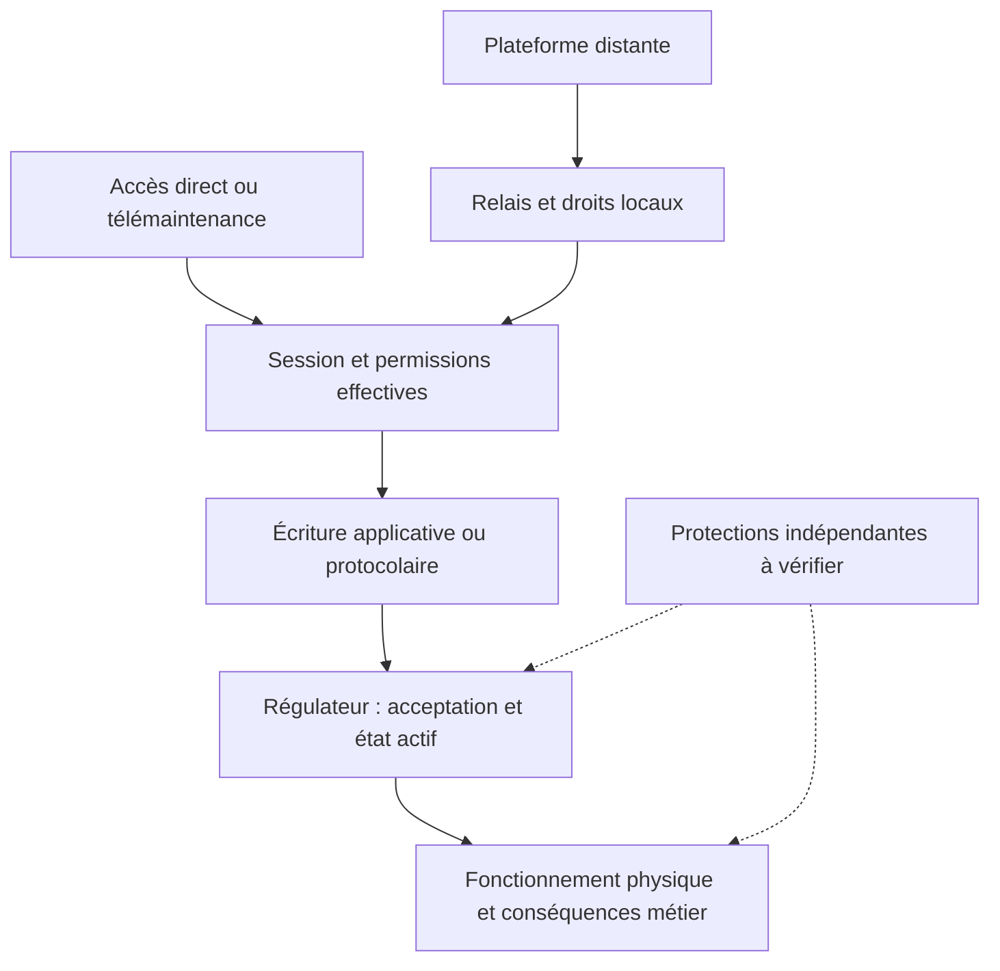

# Danfoss / XWEB : qui peut agir sur une installation frigorifique ?

**Investigation indépendante sur les chemins d'administration, les droits d'écriture et la reprise des installations frigorifiques**

**Prépublication v0.5 · 17 octobre 2026 · Candidate pour revue privée**  
**Auteur (pseudonyme) :** lxrider. **Licence du texte original :** [CC BY 4.0](LICENSE.md).  
**Contexte métier :** grandes et moyennes surfaces (GMS) alimentaires en France, leurs installations frigorifiques, la télésurveillance et les interventions de maintenance.  
**Périmètre technique :** Danfoss AK-SM/AK-SC et Copeland/Dixell XWEB.  
**Démarche :** OSINT/EASM passif, Attack Path Analysis et raisonnement tactique contradictoire. Aucun test actif sur des installations tierces.

Une supervision frigorifique relie des accès numériques à une fonction physique : conserver les denrées, surveiller les températures et permettre l'intervention du frigoriste. Selon les équipements et les droits disponibles, elle permet de modifier des consignes, des dégivrages et des paramètres d'alarme. La portée de cette administration, les protections qui lui résistent et les conditions de reprise sont au centre de cette étude. En GMS, ces questions concernent directement la conservation des marchandises, la disponibilité des équipements frigorifiques, les alertes et l’organisation des interventions.

En octobre 2026, le CERT-FR a signalé de nombreuses compromissions de contrôleurs de réfrigération Danfoss AK-SM/AK-SC et Copeland/Dixell XWEB. La gestion détaillée de son alerte indique une publication initiale le 12 octobre, l'ajout d'autres équipements ciblés le 13 et une mise à jour des recommandations le 16. Le bulletin décrit les familles concernées et les mesures de protection et de remise en service. Le vecteur initial reste indéterminé dans les informations publiques qu'il fournit.[1](#ref-1)

> Lorsqu'un accès permet d'administrer le froid, quels droits donnent effectivement prise sur le fonctionnement de l'installation, quelles protections demeurent indépendantes et qui peut reprendre le contrôle ?

## Résultats et question ouverte

| Résultat de l'investigation | Appui disponible | Portée |
|---|---|---|
| Une pièce XWEB conduit à examiner la séparation entre consignes, limites applicatives et alarmes. | **OBSERVED** pour le contenu de la capture décrit dans le dossier ; **DOCUMENTED** pour la sémantique de certaines familles de régulateurs. | Modèles réels, permissions, acceptation des écritures et effets physiques **UNKNOWN**. |
| Des professionnels du froid décrivent des responsabilités et des moyens d'action répartis entre plusieurs organisations. | Réponses enregistrées **OBSERVED** ; pratiques et perceptions **REPORTED**. | Échantillons volontaires, sans mesure de représentativité ni lien causal établi avec une compromission. |
| Six chemins candidats permettent d'examiner les frontières entre accès, session, droits et commande. | Capacités de produits **DOCUMENTED**, pratiques **REPORTED**, participation aux incidents **HYPOTHESIS**. | Aucun chemin initial confirmé sur une installation victime. |

Le résultat architectural est conditionnel et vérifiable : **lorsqu'une même autorité peut déplacer une consigne et la limite qui l'encadre, cette limite reste sous son contrôle**. L'indépendance des autres protections, embarquées ou physiques, demande une vérification distincte.

L'inconnue décisive est la provenance de la **première écriture anormale acceptée**. Pour un même site, le corpus disponible laisse ouverte la chaîne reliant accès initial, identité, commande, état actif du régulateur et effet physique. Les cinq hypothèses H1–H5 restent **INDETERMINATE** ; les trois scénarios COA-A/B/C restent ouverts.

## 1. Trois constats sur la maîtrise d'une installation frigorifique

### A. La consigne et sa limite appartiennent-elles au même domaine d'autorité ?

Le dossier de recherche consigne l'examen d'une photographie de journal XWEB, visible dans une capture reçue d'une publication présentée comme publique sur un réseau professionnel. Plusieurs groupes de lignes « Écrire paramètres », de structure voisine, y concernent des régulateurs distincts. Le statut **OBSERVED** porte sur le contenu visible de cette capture. La page d'origine, les circonstances de collecte du journal et l'authenticité de la trace industrielle restent **UNKNOWN**.

La présentation ci-dessous conserve les catégories utiles au raisonnement. Elle écarte la photographie, les valeurs, les codes de paramètres relevés, les horodatages précis, les identifiants et le lien vers la publication. Le tableau est une reconstruction analytique assainie.

| Catégorie relevée dans la pièce | Lecture de l'artefact | Appui documentaire | Vérification manquante |
|---|---|---|---|
| Consignes | Lignes apparentes d'écriture visant un réglage de consigne | Fonction de consigne décrite pour la famille XM679K v5.4 | Référence de l'instrument, valeur acceptée et état actif |
| Limites applicatives | Lignes visant aussi une borne de plage de consigne | Limite supérieure configurable dans le manuel de cette famille | Permissions effectives et application du changement |
| Dégivrage | Lignes portant sur des réglages compatibles avec le dégivrage | Fonctions dont l'effet dépend du modèle, du mode et de la configuration | Déclenchement, durée effective et effet thermique |
| Alarmes | Lignes compatibles avec des seuils ou temporisations | Paramètres d'alarme décrits dans la documentation produit | Fonction réellement affectée et fonctionnement des alertes |

Le manuel XM679K v5.4 décrit une consigne et une borne supérieure réglable de sa plage. Cette sémantique est **DOCUMENTED** pour les produits couverts par ce manuel. Son application aux instruments photographiés reste conditionnée à leur identification.[7](#ref-7)

La question d'architecture se précise ainsi : un rôle qui modifie la consigne peut-il également déplacer sa borne admissible ou modifier l'alerte associée ? Si ces opérations relèvent du même domaine de privilèges, leur contrôle demande des protections situées hors de sa portée. La présence et l'efficacité de telles protections sur l'installation photographiée sont **UNKNOWN**.

La répétition de groupes homologues sur plusieurs régulateurs est compatible avec les fonctions natives de XWEB EVO. Le manuel distingue la préparation des paramètres, leur import dans l'interface et leur transfert par *Write* vers les instruments sélectionnés.[6](#ref-6) Plusieurs mécanismes restent donc possibles : préparation humaine suivie d'un transfert groupé, automatisation externe utilisant ces fonctions, ou opérations distinctes. Le format exact du journal produit par un *Write* natif n'a pas été reproduit dans cette enquête.

L'observation appelle une revue des **droits par fonction** : lecture, préparation, édition, transfert, commande, modification des bornes et modification des alarmes. Cette revue doit aussi examiner les autres voies d'écriture et les protections propres au régulateur. Elle peut commencer par les manuels et la configuration autorisée, sans modifier les réglages d'un procédé en service.

### B. Qui peut maintenir, fermer et rétablir l'accès distant ?

L'enquête auprès des professionnels du froid a recueilli **43 participations** au questionnaire technique, dont **42 retenues pour l'exploitation technique** dans le dossier de recherche, et **25 participations** à un questionnaire distinct sur les accès réseau et leur gouvernance. Les unités comptées sont des réponses. Le recouvrement possible entre participants et l'agrégation de plusieurs installations dans certaines réponses empêchent d'en déduire un nombre de personnes indépendantes ou de magasins.

Dans le questionnaire de gouvernance :

| Déclaration | Réponses sur 25 |
|---|---:|
| Responsabilités de sécurisation jugées souvent floues | 17 |
| Application des règles du client sans pouvoir imposer les siennes | 14 |
| Accès Internet direct cité parmi les pratiques habituelles | 18 |
| Prise en main distante d'un poste froid | 11 |
| VPN cité | 7 |

Les catégories d'accès se recouvrent. Elles décrivent les pratiques générales déclarées par les répondants, avec une représentativité **UNKNOWN**. Leur présence sur une installation compromise reste à établir.

Ces déclarations **REPORTED** font apparaître une difficulté opérationnelle : l'exploitant, l'enseigne, le frigoriste, le prestataire réseau, l'intégrateur et l'astreinte peuvent détenir chacun une partie des moyens nécessaires pour protéger le service. L'un peut fournir la connexion, un autre administrer les comptes, un troisième intervenir sur les réglages et un quatrième recevoir les alarmes. Les contrats et les responsabilités effectives des sites restent **UNKNOWN**.

**Limite du volet gouvernance.** Notre collecte directe porte sur la perspective des frigoristes. Nous ne disposons pas d’entretiens directs documentés avec des directions d’enseignes, des DSI de GMS ou des responsables de magasins. Le référentiel de recherche conserve des déclarations publiques d’acteurs de la distribution, mais celles-ci ne permettent pas de vérifier les droits de décision, les contrats ou les architectures des installations concernées. Cette asymétrie des sources limite les conclusions possibles sur la gouvernance des accès.

Un témoignage direct, traité séparément des questionnaires, décrit aussi un accès de maintenance fourni par l'exploitant et parfois partagé avec d'autres usages (**REPORTED**). La segmentation, le filtrage et les communications possibles entre équipements sont **UNKNOWN**. Cette information conduit à vérifier la frontière entre usages et intervenants ; elle laisse ouverte l'existence d'un chemin latéral.

Le CERT-FR recommande de supprimer l'exposition directe et de rétablir un accès protégé. Il demande également de vérifier les conditions d'assurance avant d'interrompre la remontée des données vers le frigoriste.[1](#ref-1) Le confinement doit donc intégrer la continuité des alarmes et de l'intervention, avec un responsable capable d'organiser le service dégradé.

Pour chaque canal d'administration, il faut pouvoir identifier qui **autorise, administre, intervient, journalise, révoque, préserve l'alarme et valide la remise en service**. Cette répartition se rattache aux contrats et procédures de l'installation.

### C. Quel état de référence permet une reprise fiable ?

Des témoignages techniques décrivent des paramètres anormaux, une remise en service difficile ou la réapparition d'anomalies après correction (**REPORTED**). Le récit Danfoss détaillé et la pièce XWEB concernent des situations distinctes, dont les chronologies et les effets doivent être examinés séparément.

Une anomalie réapparue peut résulter d'une nouvelle modification distante, d'un transfert de configuration, d'une programmation locale ou différée, d'une commande de forçage (*override*) ou d'une correction incomplète. Le mécanisme en cause dans chaque récit reste **UNKNOWN**.

La documentation Danfoss AK-SM 800 décrit deux sens de transfert : *Upload* récupère les réglages des régulateurs vers la base du superviseur ; *Download* envoie les réglages mémorisés dans cette base vers les régulateurs.[8c](#ref-8c) XWEB documente également des fonctions de programmation et de transfert, selon les générations.[6](#ref-6) Ces capacités rendent plausible la réapplication d'un état enregistré ; leur rôle dans les réapparitions rapportées demeure une **HYPOTHESIS**.

La reprise pose alors une question concrète : **où se trouve la configuration de référence approuvée, et quelles opérations peuvent la remplacer ?** L'état du superviseur, celui du régulateur et celui d'une sauvegarde peuvent différer. Une sauvegarde récente peut déjà contenir des réglages anormaux.

Une validation de reprise doit identifier cette référence, vérifier le sens des transferts, examiner les programmations et forçages résiduels, contrôler les alarmes et confronter les valeurs affichées aux mesures physiques pertinentes. Le professionnel qualifié et l'exploitant doivent pouvoir valider ensemble le retour à un fonctionnement acceptable. Les essais techniques éventuels exigent un périmètre autorisé et un programme adapté aux contraintes du procédé.

## 2. Reconstituer les chemins depuis la posture de l'adversaire

### Comprendre l'environnement et chercher les conditions nécessaires

L'analyse part d'un adversaire hypothétique dont la position initiale est **UNKNOWN**. Elle reconstruit l'environnement métier, les informations accessibles, les frontières à franchir, les droits éventuellement obtenus et les effets possibles.

Trois traditions de raisonnement structurent ce travail :

- l'IPOE décrit l'environnement, ses effets sur les opérations et les modes d'action possibles, notamment dans FM 2-0 ;
- AJP-5 aide à distinguer objectifs supposés, moyens, modes d'action, contraintes et points de décision ;
- l'ACH confronte les hypothèses aux observations discriminantes et à leurs contradictions.[14](#ref-14)[15](#ref-15)[16](#ref-16)

Ces outils sont employés par analogie analytique. L'identité, l'intention et les méthodes de planification des auteurs des incidents demeurent **UNKNOWN**. L'approche INL CCE fournit un autre appui explicite : partir des conséquences critiques et raisonner depuis les possibilités de l'adversaire.[12](#ref-12)

Le travail tactique consiste ici à trouver les **conditions nécessaires à une conséquence inacceptable**, puis les endroits où la défense peut retirer une capacité d'action. Pour une perte de maîtrise thermique accompagnée d'une alerte dégradée, il faut notamment examiner les droits de régulation, les droits sur les alarmes, l'acceptation des écritures, les protections indépendantes et le délai d'intervention. Chacune de ces conditions peut modifier ou invalider le scénario.

### De l'exposition observable aux droits utilisables

ONYPHE, Censys et SecurityScorecard/Driftnet ont publié des études d'exposition reposant sur des signatures, périodes et unités différentes.[2](#ref-2)[3](#ref-3)[4](#ref-4) Claroty a documenté des vulnérabilités et des démonstrations sur des générations déterminées de Danfoss et de XWEB PRO.[5](#ref-5) Ces travaux constituent des sources antérieures ou contemporaines de l'enquête, créditées selon leur périmètre.

Notre dossier comporte également des consultations d'archives d'exposition et des contrôles hors ligne de signatures et de corrélations. Leur niveau d'observation est celui du document indexé ou de l'artefact local. La précision des empreintes sur une population d'équipements physiquement identifiés reste **UNKNOWN**. Une adresse IP, un service réseau, un document d'index et un établissement sont des unités distinctes.

L'EASM renseigne ainsi la découvrabilité extérieure. Pour reconstruire un chemin d'attaque, il faut ensuite établir la frontière d'authentification franchie, l'identité ou le mécanisme utilisé, les permissions effectives et leur portée sur les équipements et leurs fonctions.

Le schéma représente les **frontières candidates à vérifier**. Chaque flèche appelle une preuve propre à l'installation.

### Six chemins candidats

| Chemin | Frontières à examiner | Condition décisive sur une installation affectée |
|---|---|---|
| **AP-01 · Web Danfoss** | Interface StoreView, session, permissions de supervision, régulateurs | Accessibilité historique et provenance de la première écriture |
| **AP-02 · Web XWEB** | Génération, authentification, profil, édition et transfert des paramètres | Droits effectifs et écriture acceptée ; autres plans d'accès à examiner selon le produit |
| **AP-03 · Danfoss Service Tool** | Canal de maintenance, service activé, authentification, tunnel vers AK-PC | Configuration et session réellement utilisées |
| **AP-04 · Danfoss Alsense** | Identité, périmètre de gestion, fonctions de modification et System Managers | Droit d'écriture commun à plusieurs sites affectés et événement corrélé |
| **AP-05 · Copeland Connect+ / XWEB** | Autorisations de plateforme, relais de session, droits natifs XWEB | Présence du relais et permissions établies aux deux niveaux |
| **AP-06 · Poste de maintenance** | Téléassistance ou accès au poste local, session de supervision, commande | Provenance d'une première écriture rattachée à ce canal |

Les fonctions constructeur sont **DOCUMENTED** pour les produits décrits ; le poste froid relève aussi de pratiques **REPORTED**. L'implication de chacun de ces chemins dans les incidents reste **HYPOTHESIS**, avec une voie initiale **UNKNOWN**.

Plusieurs distinctions techniques gouvernent cette lecture :

- **Danfoss :** les AK-SM 800/850 historiques et les AK-SM 800A possèdent des contrôles différents. Sur 800A, le *Session Control* et l'activation de ST-500 constituent deux réglages séparés. Le bulletin R4.3.1 annonce ST-500 désactivé par défaut, avec réactivation possible pour la maintenance. Le tunnel AK-SM vers AK-PC décrit par Danfoss requiert le niveau Supervisor dans le cas documenté.[8a](#ref-8a)[8b](#ref-8b)
- **XWEB :** EVO et PRO doivent être examinés séparément. Le manuel PRO distingue notamment lecture, édition de valeurs, import et envoi de commandes. Il documente aussi une passerelle Modbus TCP/IP configurable en lecture seule ou en lecture-écriture. Les droits Web et les contrôles de ce plan protocolaire demandent une analyse distincte ; son activation dans les incidents est **UNKNOWN**.[6](#ref-6)
- **Plateformes :** Alsense documente des fonctions de réplication de réglages à l'échelle d'une flotte. Connect+ documente un relais *Terminal Mode* pour XWEB. Les autorisations de plateforme, de relais et d'application locale doivent être établies à chaque niveau.[8d](#ref-8d)[9](#ref-9)

La portée se décrit à trois échelles : **plusieurs régulateurs d'une installation, plusieurs superviseurs, plusieurs établissements**. Le motif local visible dans la pièce XWEB laisse la portée interétablissements **UNKNOWN**. L'existence d'un prestataire commun ou d'une cooccurrence d'IP laisse également ouverte la relation d'autorité effective.

### H1–H5 et COA-A/B/C : deux questions distinctes

Les hypothèses d'accès et de relations d'autorité sont conservées sans classement :

| Hypothèse | Proposition à examiner | Élément réellement discriminant |
|---|---|---|
| **H1** | Reconnaissance et compromissions distribuées | Sessions et premières écritures attribuables site par site |
| **H2** | Faiblesse d'authentification ou de configuration récurrente | Même mécanisme applicable et utilisé dans une famille et une configuration vérifiées |
| **H3** | Accès ou renseignements issus de la maintenance | Session de maintenance reliée à l'écriture, ou preuve distincte de sélection par information non publique |
| **H4** | Identité ou plateforme multisite compromise | Droit effectif et événement commun corrélés sur au moins deux sites affectés |
| **H5** | Altération de la distribution logicielle | Artefact altéré, déploiement antérieur aux effets et comportement associé |

**H1–H5 : INDETERMINATE.** Certaines hypothèses peuvent se combiner. H3 distingue l'utilisation d'un accès de maintenance et celle d'informations de ciblage. La présence d'une CVE documentée laisse son exploitation pendant ces incidents **UNKNOWN**.

Les scénarios de séquencement examinent une autre question :

| Scénario | Lecture candidate | Preuve manquante |
|---|---|---|
| **COA-A** | Préparation d'opérations pour plusieurs familles de produits | Traces de préparation et opérations comparables, datées sur des victimes indépendantes |
| **COA-B** | Adaptation successive après un premier épisode | Chronologie alignée et indices d'apprentissage entre épisodes |
| **COA-C** | Opérations indépendantes ou imitation | Origines et séquences distinctes corroborées |

La première écriture acceptée, corrélée à une identité, un chemin réseau et un état physique, serait particulièrement discriminante. Une absence de trace devient exploitable seulement après contrôle de la couverture du journal, de ses horloges, de sa rétention et de son intégrité.

### Employer MITRE ATT&CK for ICS au niveau permis par les pièces

| Référence | Qualification dans ce dossier |
|---|---|
| **T0836 · Modify Parameter** | Compatible avec les événements affichés et les modifications rapportées ; action hostile et acceptation à établir |
| **T0838 · Modify Alarm Settings** | Compatible sous réserve de la sémantique des paramètres et des versions présentes |
| **T0878 · Alarm Suppression** | **UNKNOWN** : suppression effective d'alarmes non établie |

MITRE fournit ici un vocabulaire de qualification. Pour la défense, *M0800 Authorization Enforcement* et les stratégies *DET0776* et *DET0777* orientent l'examen des autorisations et de la détection des changements de paramètres et d'alarmes.[13](#ref-13) Leur mise en œuvre dépend des traces disponibles et du fonctionnement du produit.

## 3. Cartographier l'autorité numérique sur l'installation

La synthèse prend la forme d'une **carte d'autorité numérique sur l'installation**. Elle rassemble les fonctions critiques, les droits, leurs délégations, les protections et la récupération. Elle applique au cas étudié les principes de risque industriel, de contrôle d'accès et de continuité présents dans les guides ANSSI, IEC 62443 et INL CCE.[10](#ref-10)[11](#ref-11)[12](#ref-12)

| Question | Vérification attendue | État du corpus |
|---|---|---|
| **Fonction critique** | Conséquences métier, plages et tolérances approuvées | Fonction générale documentée ; conditions propres à un site **UNKNOWN** |
| **Accès et identités** | Canaux actifs, sessions, rôles et portée | Capacités documentées ; chemin initial **UNKNOWN** |
| **Droits sur les paramètres** | Lecture, préparation, écriture, commande ; consignes, bornes et alarmes | Question étayée par la pièce et les manuels ; droits du site **UNKNOWN** |
| **Protections indépendantes** | Barrières hors de portée du domaine d'administration considéré | **UNKNOWN** sur les installations évoquées |
| **Traçabilité** | Demande, transmission, acceptation, état actif et mesure | Chaîne complète **UNKNOWN** |
| **Télémaintenance et astreinte** | Décision, révocation, continuité d'alarme et accès de secours | Difficultés **REPORTED** ; répartition contractuelle **UNKNOWN** |
| **Récupération** | Référence saine, sources de paramètres, validation physique et métier | Capacités de transfert documentées ; mécanisme des réapparitions **UNKNOWN** |

Cette carte sert à examiner les combinaisons de droits : une autorité peut-elle agir à la fois sur la régulation, sur ce qui borne son action et sur ce qui la rend visible ? Le *blast radius* décrit ici la portée technique de cette autorité sur les comptes, superviseurs, régulateurs et établissements. La portée opérationnelle dépend des fonctions frigorifiques affectables, de leur configuration et des protections indépendantes. Les conséquences métier comprennent les pertes de marchandises, l'interruption d'exploitation, la mobilisation des frigoristes et les perturbations logistiques. Leur étendue demande une évaluation propre à l'installation et à ses dépendances : une compromission techniquement limitée peut avoir des répercussions entre organisations.

Les parties 2-1 et 2-4 d'IEC 62443 situent les responsabilités des exploitants et des prestataires ; les parties 3-2 et 3-3 concernent le risque et les exigences système ; les parties 4-1 et 4-2 traitent du développement et des composants. Ce rapprochement thématique sert à orienter la vérification. Une analyse de conformité demanderait les éditions applicables et l'examen des exigences détaillées.[11](#ref-11) Les guides ANSSI apportent un cadre pour l'administration, la télémaintenance et l'exploitation, y compris dans des environnements gérés par plusieurs intervenants.[10](#ref-10)

Trois exercices sur table permettent de commencer : examiner les droits sur une consigne et sa borne ; fermer un accès distant en préservant l'alerte et l'astreinte ; rétablir une référence fiable après la réapparition d'une anomalie. Ils peuvent révéler une permission trop large, une responsabilité vacante ou une dépendance de continuité. Leur utilité comparative reste à mesurer.

## 4. Éprouver la portée de cette lecture

Une transposition pourrait être pertinente lorsqu'une installation associe une fonction physique critique, une administration numérique qui peut l'influencer, une maintenance impliquant plusieurs organisations et des protections dont l'indépendance reste à vérifier.

La chaîne du froid pharmaceutique, certaines GTB/GTC sensibles, de petites installations d'eau ou d'assainissement, des serres pilotées et des systèmes énergétiques constituent des terrains candidats. Il s'agit d'une **HYPOTHESIS de transfert**. Leur exposition, leur maturité et leur niveau de risque sortent des mesures de cette enquête.

Une évaluation autorisée pourrait comparer un audit de référence fondé sur IEC 62443 et les guides ANSSI au même audit complété par cette représentation compacte de l'autorité, des délégations et de la reprise. Les critères devraient être fixés avant l'exercice : permissions critiques supplémentaires confirmées, responsabilités clarifiées, révocations praticables, traçabilité des écritures, continuité des alarmes, capacité de récupération et charge de travail.

L'évaluation doit accepter un gain nul, une fausse piste ou un coût disproportionné. **Aucun pilote ni gain comparatif n'est établi à ce jour.** Cette proposition reste une traduction opérationnelle à éprouver face aux pratiques d'audit existantes.

## 5. Limites et éléments qui pourraient modifier l'analyse

Le corpus autorise une analyse d'architecture et de scénarios. Sa couverture demeure insuffisante pour reconstituer une chaîne forensique complète chez une victime.

Les lacunes déterminantes sont :

- l'origine de la première session et de la première écriture acceptée ;
- le modèle, le firmware et les permissions effectives des régulateurs photographiés ;
- des mesures physiques indépendantes reliées aux événements visibles ;
- une comparaison contrôlée entre installations affectées et épargnées ;
- des éléments recueillis directement auprès d’exploitants, directions d’enseignes et DSI de GMS sur les décisions d’accès, les contrats et la reprise ;
- une autorité d'écriture et un événement commun vérifiés sur plusieurs établissements ;
- un artefact attestant une altération logicielle, une persistance hostile ou une attribution.

Les questionnaires sont volontaires et déclaratifs. Les archives d'exposition portent sur des objets d'index. La pièce photographique et les témoignages ont une provenance documentée à l'échelle de leur consultation, avec une authenticité industrielle **UNKNOWN**. Ces limites s'appliquent aux conclusions qui en dépendent.

Plusieurs résultats pourraient infléchir la lecture : un journal natif XWEB reproduisant le motif observé préciserait l'explication des groupes d'écritures ; une matrice de permissions sur le modèle exact pourrait établir la séparation entre consigne et borne ; une protection physique indépendante pourrait réduire fortement les conséquences possibles ; des traces fiables pourraient rattacher une anomalie réapparue à la restauration ou à une voie d'accès différente.

Ces éléments serviraient à corriger les mécanismes proposés et leur portée. L'intention supposée d'un adversaire doit, elle aussi, rester distincte de son comportement visible, du mécanisme technique et de l'effet mesuré.

## 6. Questions pour la revue technique

L'étude relie la surface observable aux permissions effectives, puis aux conséquences possibles et aux conditions de reprise. Son intérêt repose sur des questions vérifiables : quels droits rendent une fonction physique modifiable, quelles protections résistent à ces droits et quels acteurs peuvent décider et contrôler la remise en service ?

La revue attendue porte en priorité sur :

- la séparation des permissions d'édition, de transfert et de commande selon les générations ;
- le format des journaux XWEB et la preuve d'acceptation par les régulateurs ;
- l'indépendance des protections et des alarmes ;
- la provenance des configurations restaurées et l'organisation de l'astreinte.

Les contributions utiles précisent le produit, la version, la source ou les conditions d'une reproduction autorisée, puis la portée et les explications concurrentes. Les modalités de correction figurent dans [CORRECTIONS.md](CORRECTIONS.md).

## Méthode, provenance et reproductibilité

**Classification.** **OBSERVED** qualifie un contenu directement reçu ou examiné, sans authentifier l'événement sous-jacent. **REPORTED** qualifie un fait déclaré par un tiers. **DOCUMENTED** qualifie un fait ou une capacité attesté par une source compétente, en séparant documentation produit et information d'incident. **HYPOTHESIS** qualifie une interprétation ou un scénario à tester. **UNKNOWN** qualifie une information non déterminée. **INDETERMINATE** est le jugement conservé sur les hypothèses d'accès H1–H5.

**Corpus.** Le texte dérive de l'étude technique longue v0.2, du référentiel maître v8.3.1 et de quatre annexes spécialisées v1.1 : ASM/EASM, Security Exposure Assessment, ACH H1–H5 et Adversary Posture. Ces synthèses partagent des sources et restent des analyses dérivées. Elles ne sont pas comptées comme corroborations indépendantes.

**Matériaux de l'enquête.** Ils comprennent des archives passives d'exposition, des contrôles hors ligne, des publications de recherche, des manuels constructeurs, deux questionnaires volontaires, un témoignage direct hors formulaires et la photographie de journal XWEB visible dans une capture reçue. Pour cette dernière, la provenance de consultation est celle consignée dans l'addendum v8.3.1 : publication présentée comme publique, page originale et conditions de collecte non vérifiées directement. Les pièces de provenance sont conservées hors du dépôt de publication.

**Questionnaires.** Les exports de réponses analysés au 17 octobre comportent 43 participations techniques et 25 participations de gouvernance. Les décomptes publiés ici ont été contrôlés sur ces fichiers ; la sélection de 42 contributions techniquement exploitables est celle du traitement analytique consigné. Les deux formulaires peuvent avoir des participants communs. Les résultats expriment des déclarations au niveau de la réponse.

**Contrôle externe.** Le lecteur peut examiner les sources publiques citées et les capacités qu'elles documentent. L'authentification indépendante de la photographie, des témoignages et des résultats individuels des questionnaires exige des matériaux privés absents de ce dépôt. Une démonstration produit établit une faisabilité ; son utilisation dans l'incident reste à prouver.

**Diffusion.** La photographie, sa transcription détaillée, les questionnaires bruts, les documents de scans et les informations relatives aux installations tierces restent hors publication. Le lien vers la publication contenant la photographie est également exclu. La reconstruction conserve uniquement les catégories nécessaires à l'analyse.

## Références publiques

Les références portent sur les versions identifiées ci-dessous. Contrôle éditorial effectué le **17 octobre 2026** ; les limites d'accès sont précisées à l'entrée concernée. Les pages et documents publics peuvent évoluer.

 **[1]** CERT-FR, [*Incident de sécurité ciblant les contrôleurs à distance des installations de réfrigération*](https://cert.cyber.gouv.fr/alerte/CERTFR-2026-ALE-012/), CERTFR-2026-ALE-012. Gestion détaillée du document consultée le 17 octobre 2026 : version initiale le 12 octobre ; ajout d'autres équipements ciblés le 13 ; mise à jour des recommandations le 16. Périmètre des familles et recommandations de protection et de reprise.

 **[2]** ONYPHE, [*Frigo d'importance vitale : analyse de la cyberattaque sur la grande distribution*](https://blog.onyphe.io/frigo-dimportance-vitale-analyse-de-la-cyberattaque-sur-la-grande-distribution/), 12 octobre 2026, mise à jour du 15 octobre. Mesures d'exposition et limites de reconnaissance des produits.

 **[3]** Censys, [*Frostbitten in France: A Danfoss StoreView Internet Exposure Report*](https://censys.com/blog/frostbitten-in-france-a-danfoss-storeview-internet-exposure-report/), 14 octobre 2026. Populations, chronologie et méthode d'inférence de versions propres à cette étude.

 **[4]** Aleksandr Yampolskiy et Richard Hummel, SecurityScorecard/Driftnet, [*Hackers Turned Supermarket Refrigerators Into Heaters*](https://securityscorecard.com/blog/hackers-turned-supermarket-refrigerators-into-heaters/), publication de l'éditeur datée du 14 octobre 2026, collecte du 13 octobre. Publication de l'éditeur et passages utiles contrôlés dans la page intégrale. La consultation initiale de l'enquête reposait sur des captures de l'article des auteurs.

 **[5]** Amir Zaltzman, Claroty Team82, [*Freeze the Controller, Defrost the Food: Uncovering Vulnerabilities in Danfoss Refrigeration Controllers*](https://blog.claroty.com/team82/research/freeze-the-controller-defrost-the-food-uncovering-vulnerabilities-in-danfoss-refrigeration-controllers) et [*Chilling Discoveries: Unpacking Vulnerabilities in Copeland XWEB Pro Controllers*](https://blog.claroty.com/team82/research/chilling-discoveries-unpacking-vulnerabilities-in-copeland-xweb-pro-controllers), 9 août 2026. Recherches sur AK-SM 800A et XWEB PRO ; exploitation dans les incidents d'octobre **UNKNOWN**.

 **[6]** Copeland/Dixell, [*XWEB EVO Operating Manual*, v5.6.0](https://webapps.copeland.com/Dixell/Content/Pages/Manuals/XWEBEVO/XWEBEVOV5.6.0OPERATION/XWEB-EVO-r5.6.0-OPR-EN.pdf), 2 octobre 2020, section 3.4.2.2.3 *Parameters* et sections *Global Commands* / *Scheduler* ; [*XWEB PRO Operating Manual*, r1.2.0](https://webapps.copeland.com/Dixell/Content/Pages/Manuals/XWEBPRO/XWEBPROV1.2OPERATION/XWEB-PRO-OPR-EN.pdf), 29 mars 2023, sections *Parameters*, *Users* (permissions) et *Modbus TCP/IP Gateway*, pp. 104–105 du PDF. Capacités propres à chaque génération.

 **[7]** Copeland, [*XM679K v5.4 User Manual*](https://media.copeland.com/332dde01-2d96-498d-8d50-b16d00560031/026-1223%20XM679K%20V5.4%20Rev0%20Manual.pdf), document 026-1223 **R3**, ©2025, section 16, tableau 16-1, p. 29 imprimée / p. 34 du PDF. La mention « Rev0 » reste dans le nom du fichier ; la révision R3 est celle du document consulté.

 **[8a]** Danfoss, [*Remote Connection to AK-PC Pack Controller: Tunneling through AK-SM System Manager in Service Tool*](https://assets.danfoss.com/documents/latest/375642/AQ486315982105en-000101.pdf), avril 2024, AQ486315982105en-000101. Canal de maintenance, TCP/1041 et niveau Supervisor dans le cas décrit.

 **[8b]** Danfoss, [*Tech Insider*, août 2025](https://assets.danfoss.com/documents/latest/525773/AO535443524000en-010101.pdf), AO535443524000en-010101, section AK-SM 800A R4.3.1, pp. 6–8 ; [*AK-SM 800A Series*, rubrique Session Control](https://www.danfoss.com/en/service-and-support/downloads/dcs/adap-kool-software/ak-sm-800a). Passages du bulletin contrôlés dans le PDF ; rubrique de support contrôlée par son contenu indexé.

 **[8c]** Danfoss, [*User Guide — AK-System Manager, AK-SM 800 Series*](https://assets.danfoss.com/documents/latest/56759/BC316842192932en-001001.pdf), BC316842192932en-001001, mars 2020, section *System Upload / Download*, p. 15. Section contrôlée dans le PDF constructeur récupéré lors de la vérification finale.

 **[8d]** Danfoss, [*Alsense Food Retail*](https://assets.danfoss.com/documents/latest/571768/AD501638525468en-000201.pdf), AD501638525468en-000201, février 2026, pp. 13–14 du PDF, *ServiceHub* et *Schedule and setpoint broadcasts*. Révision effectivement consultée après redirection du lien constructeur antérieur. Fonctions de gestion de flotte documentées ; déploiement et droits chez les victimes **UNKNOWN**.

 **[9]** Copeland, [*Connect+ Administrator User Guide*](https://media.copeland.com/9cedbcc8-b138-476e-b467-b16d0050514f/026-1025%20Connect%2B%20Administrator%20User%20Guide.pdf), 026-1025 R4, ©2024, annexe A, tableau A-4, p. 48 imprimée / p. 51 du PDF : *Terminal Mode (HttpSessionProxyActivity)* pour les protocoles XWEB.

 **[10]** ANSSI, [*La cybersécurité des systèmes industriels : mesures détaillées*](https://messervices.cyber.gouv.fr/guides/la-cybersecurite-des-systemes-industriels-mesures-detaillees), ANSSI-PA-108 v2 du 27 novembre 2025, notice publiée le 19 décembre 2025 ; [*Recommandations de sécurité relatives à la gestion technique et centralisée du bâtiment (GTB/GTC)*](https://messervices.cyber.gouv.fr/guides/recommandations-gestion-technique-batiment), ANSSI-PA-110 du 27 avril 2026, notice publiée le 4 juin 2026. Documents de contrôle : [PDF Mesures détaillées](https://messervices.cyber.gouv.fr/documents-guides/Guide_Systemes_industriels__Mesures_detaillees_v2.pdf) et [PDF GTB/GTC](https://messervices.cyber.gouv.fr/documents-guides/Guide__Systemes_industriels___GTB_GTC_2025.pdf).

 **[11]** ISA, [*ISA/IEC 62443 Series of Standards*](https://www.isa.org/standards-and-publications/isa-standards/isa-iec-62443-series-of-standards), catalogue et présentation publique des parties 2-1, 2-4, 3-2, 3-3, 4-1 et 4-2. Rapprochement thématique ; éditions ISA et IEC à déterminer pour tout usage de conformité.

 **[12]** Idaho National Laboratory, [*Consequence-driven Cyber-informed Engineering (CCE)*](https://inl.gov/national-security/cce/), présentation de l'approche par conséquences et posture de l'adversaire.

 **[13]** MITRE, [*ATT&CK for ICS*](https://attack.mitre.org/matrices/ics/) : [T0836 — Modify Parameter](https://attack.mitre.org/techniques/T0836/), [T0838 — Modify Alarm Settings](https://attack.mitre.org/techniques/T0838/), [T0878 — Alarm Suppression](https://attack.mitre.org/techniques/T0878/), [M0800 — Authorization Enforcement](https://attack.mitre.org/mitigations/M0800/), [DET0776 — Detection of Modify Parameter](https://attack.mitre.org/detectionstrategies/DET0776/), [DET0777 — Detection of Modify Alarm Settings](https://attack.mitre.org/detectionstrategies/DET0777/). Identifiants et objets contrôlés au 17 octobre 2026.

 **[14]** U.S. Army, *FM 2-0, Intelligence*, 1er octobre 2023, chapitre 5, IPOE. Édition identifiée dans le [catalogue doctrinal officiel IKN](https://www.ikn.army.mil/apps/IKNHostedWebsites/Home/LoadPublishedPage?PageUID=30c204aa-de54-471a-8252-2df7d9f5a5cc). Le PDF intégral de cette édition n'a pas pu être récupéré lors du contrôle ; son usage analytique est repris du corpus de travail.

 **[15]** OTAN, [*AJP-5, Allied Joint Doctrine for the Planning of Operations*](https://www.gov.uk/government/publications/allied-joint-publication-ajp-05a-allied-joint-doctrine-for-the-planning-of-operations), édition B, version 1, 2026. Notice du Ministry of Defence mise à jour le 14 octobre 2026 ; édition B annoncée le 19 juin. Usage par analogie analytique.

 **[16]** Richards J. Heuer Jr., [*Psychology of Intelligence Analysis*](https://www.cia.gov/resources/csi/books-monographs/psychology-of-intelligence-analysis-2/), CIA Center for the Study of Intelligence, 1999, chapitre 8, *Analysis of Competing Hypotheses*, consulté dans le PDF public de l'ouvrage.

---

## Annexe A — Des résultats d'investigation aux contrôles de cybersécurité industrielle

Cette matrice relie les résultats des sections 1 à 3 à des vérifications autorisées. La *supply chain* désigne ici les délégations d'accès, de décision et de maintenance ; l'altération logicielle relève de H5.

**Références.** IEC 62443 situe les parties et domaines : éditions et clauses restent à examiner pour une évaluation de conformité. **SI** et **GTB** désignent les deux guides ANSSI [10](#ref-10), avec leurs classes C1/C2 et niveaux N1/N2 à contextualiser. MITRE apporte classification et détection ; INL CCE, une méthode par conséquences. Les vérifications ci-dessous sont proposées par l'étude.

### A1. Autorité de modification des paramètres et indépendance des protections

| Champ | Correspondance opérationnelle |
|---|---|
| **Problème identifié** | La pièce XWEB présente des écritures apparentes concernant une consigne, sa limite applicative et des paramètres d'alarme. La capacité d'une même autorité à modifier ces fonctions doit être vérifiée sur la génération et la configuration concernées. |
| **Preuve disponible** | Contenu de capture **OBSERVED** ; sémantique par famille **DOCUMENTED** ; droits réels, acceptation et protections indépendantes **UNKNOWN**. |
| **Références pertinentes** | **Normes :** IEC 62443-3-3 et 4-2, contrôle d'usage et intégrité ; 4-1, développement sécurisé [11](#ref-11). **Recommandations :** SI R85/C1, droits par profil ; R196/C2, contrôles des compteurs/horloges, cohérence et plages dans la logique de l'automate ; R198/C2, logique et vérification des limites de consigne dans l'automate (pp. 94–95 imprimées) [10](#ref-10). **MITRE :** M0800, autorisation [13](#ref-13). |
| **Vérification proposée** | Relever les droits par fonction et canal (Web, relais, protocole), sur modèle et firmware identifiés. Vérifier qui peut modifier les contrôles embarqués et leurs bornes ; établir les protections hors de portée de ces droits. La transposition des recommandations sur les automates aux régulateurs frigorifiques dépend du modèle et de la configuration. |
| **Responsabilités à établir** | Exploitant/DSI : autorisations ; frigoriste/intégrateur : régulation ; fabricant : capacités et séparations offertes. |
| **Résultat attendu** | Matrice fonctions/rôles/canaux et liste des protections dont l'indépendance est établie, limitée ou **UNKNOWN**. |

### A2. Télémaintenance, délégation des accès et responsabilités interorganisationnelles

| Champ | Correspondance opérationnelle |
|---|---|
| **Problème identifié** | Fourniture du lien, administration, intervention, budget et continuité de l'astreinte sont répartis entre plusieurs acteurs. |
| **Preuve disponible** | Réponses **OBSERVED**, pratiques **REPORTED** dans deux enquêtes volontaires auprès de professionnels du froid ; perspective directe des enseignes et exploitants, périmètre contractuel et lien causal avec les incidents **UNKNOWN**. |
| **Références pertinentes** | **Normes :** IEC 62443-2-1, exploitant ; 2-4, prestataires [11](#ref-11). **Recommandations :** SI R2/C1, responsabilités ; R129/C1 et R130/C2, accès distants, authentification et traces ; GTB R6/N1, accès distant par VPN IPsec [10](#ref-10). |
| **Vérification proposée** | Retracer décision, financement, ouverture, intervention et révocation jusqu'au compte utilisé. Examiner durée, périmètre, authentification et traces. Dérouler sur table une coupure nocturne préservant l'alarme et un accès de secours maîtrisé. |
| **Responsabilités à établir** | Exploitant, DSI, frigoriste, prestataire réseau/télécom et astreinte ou télésurveilleur, selon leurs pouvoirs effectifs et leurs contrats. |
| **Résultat attendu** | Accord opérationnel avec propriétaires des canaux, décideurs joignables, moyens de révocation et surveillance en mode dégradé. |

### A3. Chemins possibles, capacités adverses et limitation des conséquences

| Champ | Correspondance opérationnelle |
|---|---|
| **Problème identifié** | Relier la découvrabilité à une autorité d'écriture, puis à ses conséquences, exige de vérifier chaque frontière. |
| **Preuve disponible** | Index **OBSERVED**, tiers **REPORTED**, capacités **DOCUMENTED**, chemins **HYPOTHESIS** ; accès initial et intentions **UNKNOWN**. H1–H5 **INDETERMINATE**, COA-A/B/C ouverts. |
| **Références pertinentes** | **Normes :** IEC 62443-3-2, risque, zones et conduits ; 3-3, restrictions des flux [11](#ref-11). **Recommandations :** GTB R4/N1 et R5/N2, cloisonnement et filtrage [10](#ref-10). **MITRE :** T0836/T0838 compatibles ; T0878 **UNKNOWN** [13](#ref-13). **Méthode :** INL CCE, conséquences critiques et posture adverse [12](#ref-12). |
| **Vérification proposée** | Parcourir AP-01 à AP-06 depuis les informations accessibles à l'adversaire hypothétique : prérequis, droits, contre-indices, points de rupture. Distinguer régulateurs, superviseurs et établissements ; borner les conséquences par les protections et moyens de reprise vérifiés. |
| **Responsabilités à établir** | Exploitant/métier : conséquences ; DSI, intégrateur, mainteneur : frontières ; fabricant/opérateur de plateforme : portées d'autorisation. |
| **Résultat attendu** | Chemins annotés, portée technique des droits, fonctions frigorifiques affectables et conséquences métier distinguées ; points de rupture et preuves manquantes. |

### A4. État sain, traçabilité des écritures et continuité du fonctionnement frigorifique

| Champ | Correspondance opérationnelle |
|---|---|
| **Problème identifié** | Une configuration conservée peut réintroduire des réglages anormaux. Le journal applicatif, l'état accepté et la mesure physique couvrent des étapes distinctes. |
| **Preuve disponible** | Réapparitions **REPORTED**, transferts constructeur **DOCUMENTED** ; mécanisme causal, première écriture acceptée et chaîne complète de traces **UNKNOWN**. |
| **Références pertinentes** | **Normes :** IEC 62443-2-1, gestion opérationnelle ; 3-3, intégrité et disponibilité [11](#ref-11). **Recommandations :** SI R9/C1 et R10/C1, configurations et restauration ; R74/C1, cyber dans les PRA/PCA ; R206/C2, traces des changements [10](#ref-10). **Détection MITRE :** DET0776 et DET0777 [13](#ref-13). |
| **Vérification proposée** | Identifier référence approuvée, programmations, forçages et sens des transferts. Relier session, demande, transmission, acceptation, état actif et mesure ; contrôler horloges et rétention. Définir les critères de reprise thermique et d'alarme, en tenant compte de la maintenance autorisée. |
| **Responsabilités à établir** | Exploitant, frigoriste, DSI, intégrateur : référence, traces, restauration ; télésurveilleur et métier : continuité et validation. |
| **Résultat attendu** | Référence saine approuvée, couverture des traces explicitée et procédure de reprise assortie d'une validation physique et métier. |
