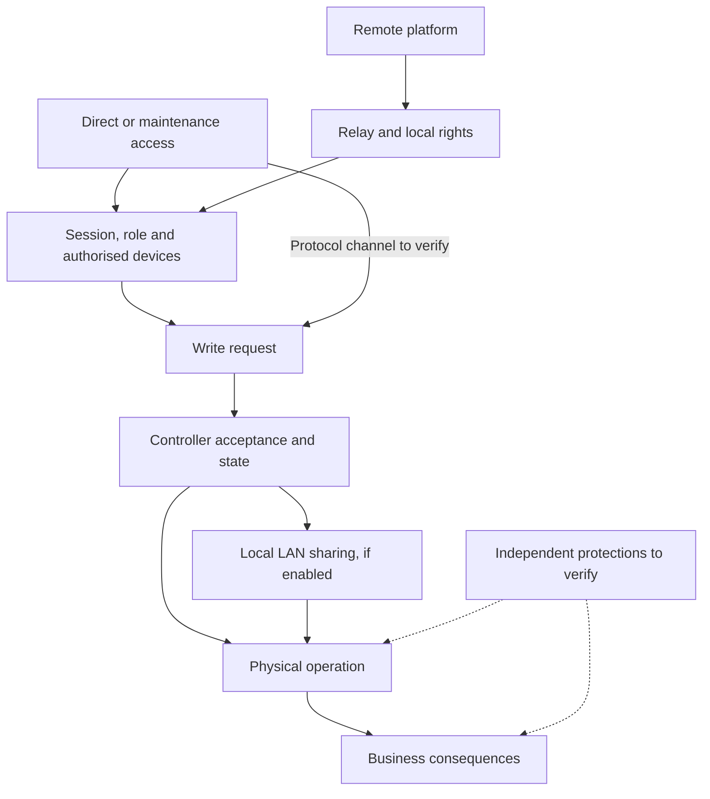

# Danfoss / XWEB: who has authority over a refrigeration installation?

**An independent investigation of access paths, modification rights and recovery in refrigeration installations**

**v1.1 — Update of 22 October 2026 (initial publication: 18 October 2026)**  
**Author (pseudonym):** lxrider. **Original text:** [CC BY 4.0](LICENSE.md).  
[Version française](ETUDE.md) · [Home](README.md) · [Corrections](CORRECTIONS.md)

In October 2026, refrigeration disruptions were reported in food retail. For a store, losing control of refrigeration threatens product preservation, can interrupt trading and places maintenance teams under immediate pressure. Understanding these incidents requires answers to three questions: **how could the equipment be accessed, who could change its operation, and why were some installations affected while others were spared?**

CERT-FR reported numerous compromises of Danfoss AK-SM/AK-SC and Copeland/Dixell XWEB remote controllers. Its alert was published on 12 October, expanded to other equipment on 13 October and revised on 16 October to update its recommendations. It establishes the scope of the product families reported and the recommended measures; it does not establish the initial attack vector.[1](#ref-1)

This study examines refrigeration installations in French food supermarkets and hypermarkets (grandes et moyennes surfaces, or GMS), their remote monitoring and their maintenance. A supervisory system connects digital access to physical functions: control, defrosting, detection of abnormal conditions and maintenance intervention. We compared Internet exposure observations, testimony and product documentation to reconstruct the authority that could act on these functions. In industry terminology, this refrigeration supervision may form part of technical centralised management (GTC), without necessarily constituting a building management system covering every building service. No active testing was performed on third-party installations.

## Findings and the unresolved question

Our investigation identifies four main findings:

- **Remote access depends on several parties.** The accounts received indicate that responsibility for configuring, administering and securing access may be shared among operators, IT departments and service providers. These practices are **REPORTED**; their role in the compromises remains **UNKNOWN**.
- **Similar disruptions do not establish a common attack path.** Danfoss and XWEB technologies have different administration capabilities (**DOCUMENTED**). No common entry vector has been established.
- **The apparent XWEB changes show functional consistency.** The photograph examined shows sequences of changes targeting setpoints, their limits, defrosting and certain alarm parameters (**OBSERVED**). A static comparison of seven manufacturer libraries improves our technical understanding of these parameters. A prepared configuration is plausible, but the tool used, the operator's knowledge and intent remain **UNKNOWN**.
- **A logged command does not prove successful execution.** Preparation, writing and reading are separate functions (**DOCUMENTED**). We lack the evidence needed to confirm that each change was accepted by a controller or to establish its physical consequences.

### Is a configurable limit a genuinely independent safeguard?

In some Dixell controller families, the temperature setpoint (`SEt`) is constrained by a configurable upper limit (`US`).

That limit can ordinarily prevent some out-of-range setpoints. However, **if the same identity has the rights to modify both the setpoint and its limit, the limit is not an independent safeguard against actions by that identity**.

The XWEB log shows apparent write events concerning both parameters. It does not establish that the changes were accepted, or that a single identity actually held all the necessary permissions.

Other protections must be assessed separately: can they still operate if the supervisory system or controller is compromised? Do they protect the equipment, continuity of refrigeration, the goods being stored or only anomaly detection?

**The decisive question remains the origin of the first accepted abnormal write.** H1–H5 remain **INDETERMINATE**, and COA-A/B/C remain open and unranked. Evidence labels are defined under “Method, provenance and reproducibility”.

## 1. Four findings from the investigation

### A. Remote access also results from organisational decisions

The technical questionnaire received **43 submissions**, of which **42 were retained for technical analysis** in the research record. A separate questionnaire on network access and its governance received **25 submissions** in the 17 October snapshot. The units counted are responses. Overlap between participants and the inclusion of several installations in some responses prevent these totals from being treated as numbers of independent people or stores.

| Statement in the governance survey | Responses out of 25 |
|---|---:|
| Security responsibilities considered frequently unclear | 17 |
| Following the client's rules without being able to impose their own | 14 |
| No clearly defined rules known | 8 |
| Direct Internet access cited among usual practices | 18 |
| Remote control of an on-site refrigeration workstation | 11 |
| VPN cited | 7 |

These categories overlap. They describe **REPORTED** practices and perceptions in a self-selected sample whose representativeness remains **UNKNOWN**. Internal reconciliation of the exports establishes that the 24 responses in the earlier snapshot were retained and one response was added: the earlier figures of 24/16 and the later figures of 25/17 represent two collection states, without retrospectively correcting respondents' statements.

Free-text responses describe access arrangements requested by the client, provided by its IT department or left to the maintenance provider, including cellular connections. Others describe difficulty obtaining access suitable for monitoring. **A 4G connection alone says nothing about addressing, filtering or whether a VPN is present.** These accounts illustrate a possible distribution of decisions; they do not establish a victim's architecture or the cause of its compromise.

Direct testimony, separate from the questionnaires, describes access provided by the operator and sometimes shared with other uses (**REPORTED**). Segmentation and lateral connectivity remain **UNKNOWN**. A shared access device may serve isolated segments or a common network; the evidence does not distinguish these configurations.

The operator, retail group, IT department, refrigeration contractor, network provider, integrator and on-call team may each hold part of the means to act. One party may provide connectivity, another administer accounts, a third change settings and a fourth receive alarms. We have no documented direct interviews with retail group management, GMS IT departments or store managers. Contracts, decision-making powers and actual responsibilities remain to be established.

This interpretation of the *supply chain* concerns **delegated access, maintenance and recovery decisions**. Intrusion into a service provider or software tampering remain separate hypotheses. CERT-FR also asks operators to check insurance conditions before interrupting Internet data transmission to the refrigeration contractor.[1](#ref-1) Containment must account for alarm continuity, on-call response and degraded operation.

### B. Comparable consequences do not identify a common vector

The Danfoss accounts and the XWEB artefact describe separate contexts. They do not form a single forensic timeline. Setpoints, defrosting or alarms can be changed in several ecosystems without the same access path, vulnerability or actor being involved.

| Family or generation | Relevant technical distinction | What remains to be established for the incidents |
|---|---|---|
| **Historical Danfoss AK-SM 800/850** | Permissions depend on profile and function. The Supervisor level required for a particular maintenance tunnel does not automatically apply to every Web command. | The model, configuration, role and channel actually used. |
| **Danfoss AK-SM 800A** | *Session Control* and ST-500 activation are separate settings. The R4.3.1 bulletin states that ST-500 is disabled by default and can be re-enabled for maintenance. | The historical state of these controls; no extrapolation to earlier generations. |
| **Historical XWEB / Classic** | Instrument libraries use `.xw5` files, distinct from application version and controller firmware. | The library actually loaded and the family of the photographed system. |
| **XWEB EVO** | Preparation, import into the application table, parameter selection and *Write* to one or more instruments are separate stages. | Effective permissions, validation and the outcome of each operation. |
| **XWEB PRO** | The manual distinguishes permissions and documents a Modbus TCP/IP gateway that can be disabled, read-only or read-write, with an optional network whitelist. | Activation and control of this alternative channel; PRO functions are not assumed to exist in EVO. |

These capabilities are **DOCUMENTED** for the products and revisions cited.[6](#ref-6)[8a](#ref-8a)[8b](#ref-8b)[8c](#ref-8c)[17](#ref-17) Their presence and use on affected installations remain **UNKNOWN**. The vulnerabilities published by Claroty concern identified generations; their exploitation during the October incidents has not been established.[5](#ref-5)

Comparison of affected and spared installations primarily limits interpretation. **22 respondents** to the technical questionnaire report encountering both affected and spared installations. Within those 22 responses, the selected differences are as follows; multiple choices were allowed:

| Reported difference | Respondents out of 22 |
|---|---:|
| Supervisory controller model or version | 14 |
| Remote access method | 10 |
| Network configuration or filtering | 8 |
| Maintenance account configuration | 5 |
| No difference identified | 4 |

Only **two** of these respondents supplied a firmware version; only one of those two also selected “model or version”. The evidence therefore contains neither fourteen verified firmware comparisons nor twenty-two controlled store pairs. A reported public interface with no observed changes challenges a deterministic “exposed therefore compromised” interpretation, without demonstrating effective protection or an attempted attack. Perceived differences remain **REPORTED**, without measured causal significance.

### C. The apparent changes make functional preparation plausible

The XWEB artefact is a photograph of a log visible in a received screenshot of a post presented as public on a professional social network. The original page, collection circumstances and authenticity of the industrial record remain **UNKNOWN**. **OBSERVED** applies only to the visible content examined.

The recorded review identifies **39 apparent write entries**, arranged in **three series of thirteen** concerning three controllers, with identical code/target pairs. A partial group concerns another controller. The publication retains the analytical pattern; it excludes the photograph, its transcription, initial and target values, detailed timestamps, identifiers and the link to the original post.

The documentary comparison concerns the following categories:

| Category | Reading of the artefact | Manufacturer support | Limitation |
|---|---|---|---|
| Setpoints | Apparent requests targeting setpoint settings | Setpoint and operating modes described by family | Accepted state and active mode unknown |
| Application limits | A range limit is also targeted | Configurable setpoint bounds | Effective rights to change both setpoint and bound must be established |
| Defrosting | Several settings compatible with this function | Initiation, duration and probes depend on model | No actual cycle or thermal effect inferred |
| Alarms | Thresholds or delays apparently targeted | Dictionaries and functions vary across generations | Effective reduction of detection not established |

**Static comparison of XM679K libraries.** Offline examination of seven official files from the historical XWEB catalogue, reproduced during the 18 October check, searches for codes as exact entries in the parameter dictionary (`P`). All seven SHA-256 hashes match those retained from the analysis. No manufacturer installer was executed.[17](#ref-17)

| Historical library version | Manufacturer identifier of the XM679K file | Examined codes present | `ddA` / `FAd` | `rA2` / `A2d` |
|---|---|---:|---|---|
| v0.9 | `003200090000` | 13/13 | Present | Absent |
| v1.3 | `0032000D0001` | 13/13 | Present | Absent |
| v3.4 | `003200220012` | 13/13 | Present | Absent |
| v3.9 | `003200270018` | 13/13 | Present | Absent |
| v4.2 | `0032002A001D` | 13/13 | Present | Absent |
| v4.3 | `0032002B001E` | 13/13 | Present | Absent |
| v5.4 | `003200360029` | 11/13 | Absent | Present |

This **OBSERVED** result refutes the objection that the thirteen codes could not belong to a single XM679K library: six older dictionaries contain them. Conversely, the historical v5.4 dictionary examined does not contain `ddA` or `FAd`. This constrains the hypothesis that this particular dictionary was used without translation or modification; it identifies neither the photographed controllers' firmware nor their actual libraries.

The parameter tables in the 2015 XM670K/XM679K manual associate `ddA` with the defrost probe temperature alarm delay and `FAd` with the fan probe temperature alarm delay. Some prose labels are less consistent than the tables. The 2022 XM669K/XM679K v5.4d manual presents a different set, including `rA2` and `A2d`, without the two earlier codes in the document examined.[7a](#ref-7a)[7b](#ref-7b) This documentary evolution prevents the semantics of one generation from being applied indiscriminately to another.

The format boundary also matters: historical `.xw5` files, EVO library packages, the XWEB version and controller firmware are four different objects. The EVO manual rules out direct loading of Classic files. EVO packages were not decoded into a reliable semantic dictionary in this investigation; the `.xw5` results are not extrapolated to them.[6](#ref-6)[17](#ref-17)

**Adversary posture interpretation.** If the log represents actual hostile actions and its semantics match a compatible family, the combined selection of setpoints, bounds and alarm settings makes preparation directed at refrigeration operation plausible (**HYPOTHESIS**). Prior refrigeration knowledge is one possible explanation. Native tools, a configuration prepared by someone else, progressive learning or separate actions are competing explanations. The evidence cannot determine the operator's knowledge or intent.

A native *Write* can send prepared parameters to several compatible devices. Local repetition is therefore compatible with human preparation followed by a grouped transfer, successive operations or external automation. The two visible ZIP imports are marked as errors and occur after the first series; they cannot be described as the successful import that triggered it. Activity from a local scheduling component does not establish a hostile task.[6](#ref-6)

**Target preparation, value preparation, local transmission and coordination between establishments** must be distinguished. None of these levels automatically demonstrates the next.

### D. A displayed command, active state and physical effect are different stages

In the EVO manual, **Import** loads values into the working table; **Write** transfers them to selected instruments; **Read** queries the instruments. Invalid values are flagged; a red value blocks the native write operation as documented. However, the significant-action log does not specify, in the material consulted, what each entry guarantees for an individual parameter and instrument.[6](#ref-6)

| Stage | Required check | Status for the XWEB artefact |
|---|---|---|
| Permission | The role, device, function and channel actually authorised | **UNKNOWN** |
| Preparation | Library, values and application validation | Functions **DOCUMENTED**, incident state **UNKNOWN** |
| Transmission | Request actually sent and outcome for each instrument | Apparent entries **OBSERVED**, transmission **UNKNOWN** |
| Acceptance | Relevant acknowledgement and controller validation result | **UNKNOWN** |
| Active state | Readback, storage and effective control mode | **UNKNOWN** |
| Physical effect | Independent measurements, output states, probes and actuators | **UNKNOWN** |
| Alerting and protection | Detection, alarm delivery and action of independent barriers | **UNKNOWN** |

*Read Parameters*, *Edit Parameters Value*, *Parameters Visibility Level*, *Import Parameters* and *Send Commands* authorise different functions. Library visibility categories `Pr1`, `Pr2` and `N.V.` do not establish Web or protocol permissions. A role name displayed in a log does not identify a person. The Modbus TCP gateway documented for PRO requires its own configuration and control review, separate from Web interface roles.[6](#ref-6)

Manufacturer rules provide useful tests of competing interpretations:

| Mechanism | Constraint documented or observed in a library | Implication for interpretation |
|---|---|---|
| `US` / `SEt` | The setpoint is bounded by `LS` and `US`; some `US` rules also refer to the setpoint. | A configurable bound requires an authority review; displayed entry order proves neither frame order nor validation order. |
| `ALC` / `ALU` | In the families examined, the relative Celsius range is 0–50; the absolute range depends in particular on `ALL` and may extend to 150 °C. | A value admissible in one mode may be invalid in another; actual mode, unit, library and firmware remain unknown. |
| `CCS` / `rSE` | A continuous-cycle setpoint requires that mode to be active; the effective setpoint may incorporate other functions. | A displayed setpoint is neither a universally active setpoint nor a measured temperature. |
| Defrosting and probes | Clock or interval initiation, installed/configured probes and faults influence the cycle; `MdF` may bound a duration or act as the duration depending on configuration. | Displayed parameters alone establish no specific cycle or physical delay. |
| Alarm delays and thresholds | Semantics, sensor and activation depend on generation. | An alarm setting change demonstrates neither suppression nor neutralisation of all protections. |

These constraints are **DOCUMENTED** by family or **OBSERVED** in historical dictionaries, without evidence of their application to the photographed devices.[7](#ref-7)[7a](#ref-7a)[7b](#ref-7b)[17](#ref-17) Accepted grouped requests, partial acceptance, rejection, an interface-only trace, another library or another channel remain possible. Compatibility with a software range does not establish controller acknowledgement.

The manufacturer also states that the XM669K/XM679K instrument covered by the v5.4d manual must not be used as a safety device.[7b](#ref-7b) Qualifying a protection as independent requires three checks: **the authority** able to change or disable it; **its physical and functional ability** to operate despite disruption; and **the objective protected**, whether equipment, refrigeration continuity, products or detection. A pressure safety device may protect a compressor without preserving the products. The state of protections at affected installations remains **UNKNOWN**.

## 2. Reconstructing paths from the adversary's position

### From observable exposure to usable rights

The analysis starts with a hypothetical adversary whose access, initial knowledge and intent are **UNKNOWN**. It examines the information the adversary might obtain, the boundaries to cross, the available functions and the conditions required for an unacceptable consequence. The approaches actually used were ASM/EASM, Attack Path Analysis, Adversary Posture and functional analysis of consequences.

ONYPHE, Censys and SecurityScorecard/Driftnet published measurements based on different signatures, periods and units.[2](#ref-2)[3](#ref-3)[4](#ref-4) Our investigation separates them from its own passive archive queries and offline checks.

Censys reports **1 825 French StoreView hosts on 11 October, falling to 537 on 14 October**. This reduction in indexed visibility does not measure the number of remediated stores. Driftnet's 13 October collection reports **5 282 StoreView IP/port observations across 4 642 IPs**, and **6 340 XWEB IP/port observations** in its populations. These results are **REPORTED**, under the authors' methods; they are neither merged with our measurements nor converted into victim counts.[3](#ref-3)[4](#ref-4)

| Netlas record retained in the research corpus | StoreView | XWEB | Unit and limitation |
|---|---:|---:|---|
| Index labelled 10 September 2026 | 2 080 | 2 215 | Response documents within the scope of the archived queries |
| Index labelled 29 September, responses filtered to before 11 October | 1 716 | 1 825 | Documents; overlapping windows, without a homogeneous time series or victim count |

These figures, **OBSERVED** at index level, cannot be added together. Index date, response timestamp, export date and incident onset are different reference points. Re-examination of five previously archived StoreView exports covers **100 records**, whose union contains **87 distinct services** defined by IP/port/protocol. Duplicates across exports prevent these from being treated as one hundred independent devices or a national estimate.

A separate XWEB batch contains **20 responses**, across **19 IPs** and **20 services**: **14** `XWEB EVO` titles, **6** `XWEB` titles, **19** HTTP URIs and **1** HTTPS URI. Response timestamps run from **3 to 10 October**, although the index is labelled **29 September**. The generic `XWEB` title also appears with a certificate carrying an XWEB PRO name. This counter-example invalidates automatic classification as “generic title therefore older generation”; it does not certify the device model.

Offline signature and relationship checks assess the consistency of the examined artefacts. They do not measure fingerprint accuracy against a physically identified equipment population. An interface, favicon, certificate, JavaScript resource or shared IP does not establish firmware, ownership or an authority relationship. Counts of search engine records, services, controllers and stores remain separate.

EASM therefore establishes generic historical discoverability. Moving to an incident path requires a victim's historical exposure, a boundary actually crossed, then an identity, permissions and command linked to that installation.

### Six candidate paths and local propagation

The diagram represents **candidate boundaries to verify**. Every arrow requires product- and installation-specific evidence; a protocol channel does not automatically inherit Web controls.

| Path | Boundaries to examine | Decisive condition at an affected installation |
|---|---|---|
| **AP-01 · Danfoss Web** | StoreView interface, session, supervisory permissions, controllers | Historical accessibility and origin of the first write |
| **AP-02 · XWEB Web** | Generation, authentication, profile, editing and transfer; alternative channel depending on product | Effective rights and accepted write; separate control of other access planes |
| **AP-03 · Danfoss Service Tool** | Maintenance channel, enabled service, authentication, tunnel to AK-PC | Configuration and session actually used |
| **AP-04 · Danfoss Alsense** | Identity, management scope, modification functions and System Managers | Common write rights across several affected sites and a correlated event |
| **AP-05 · Copeland Connect+ / XWEB** | Platform authorisations, session relay, native XWEB rights | Relay presence and permissions established at both levels |
| **AP-06 · Maintenance workstation** | Remote assistance or local workstation access, supervisory session, command | Origin of a first write linked to this channel |

Manufacturer capabilities are **DOCUMENTED** for the products described; refrigeration workstation practices are also **REPORTED**. The AK-SM to AK-PC tunnel described by Danfoss requires Supervisor level in the documented case. Alsense describes fleet setting replication functions; Connect+ documents a *Terminal Mode* relay for XWEB. Platform, relay and local application authorisations remain distinct.[8a](#ref-8a)[8d](#ref-8d)[9](#ref-9) The involvement of any individual path in the incidents remains **HYPOTHESIS**.

Local scope requires an additional layer. The XM669K/XM679K v5.4d documentation describes a network of **up to eight sections**, with optional synchronisation of setpoints (`LSP`), defrost initiation (`LMd`) and completion (`dEM`). It also describes local/MultiMaster administration and the effective setpoint `rSE`.[7b](#ref-7b) When enabled, these functions can extend consequences within an installation; they establish neither separate writes to each section nor their recording in XWEB. Their activation during the incidents is **UNKNOWN**.

This propagation layer supplements AP-01 to AP-06 without creating a seventh initial access path. **Multiple controllers within one installation, multiple supervisory systems and multiple establishments** must be distinguished. To support the claim that multisite authority was actually used, three facts must be established separately: connectivity to several sites, usable write rights at those sites and a common event correlated with at least two affected sites. A shared provider, common tool or similar settings are insufficient.

### H1–H5 and COA-A/B/C: access and sequencing

The hypothesis analysis is **structured and informed by ACH principles**: seek incompatibilities, competing explanations and discriminating observations. It does not claim complete execution of a formal procedure.[16](#ref-16)

| Hypothesis | Proposition to examine | Genuinely discriminating evidence |
|---|---|---|
| **H1** | Reconnaissance and distributed compromises | Sessions and first writes attributable site by site |
| **H2** | Recurring authentication or configuration weakness | The same mechanism applicable and used within a verified family and configuration |
| **H3** | Maintenance-derived access or information | A session linked to a write, or separate evidence of target selection using non-public information |
| **H4** | Compromised multisite identity or platform | Effective rights and a common event correlated across at least two affected sites |
| **H5** | Software distribution tampering | Altered artefact, deployment before effects and associated behaviour |

**H1–H5: INDETERMINATE.** Some hypotheses may combine. H3 separates use of maintenance access from use of maintenance information. Neither an altered software artefact nor use of a CVE is established in the incident corpus.

**Institutional update, 21 October 2026.** According to reports of ANSSI director-general Vincent Strubel's hearing before a French Senate committee, the agency's stated assessment does not support exploitation of the vulnerabilities disclosed by researchers over the previous two years. Instead, he pointed to basic security shortcomings: management interfaces directly exposed to the Internet, insufficiently protected administration and weak passwords.[18](#ref-18) This institutional assessment is **REPORTED** by news outlets; it is not forensic evidence available in our corpus. It adds weight to examining exposure, configuration and authentication under H1/H2 without demonstrating distributed compromises, one shared mechanism, a cross-site identity or the exhaustive exclusion of other routes. The first sessions and accepted writes remain **UNKNOWN**, and H1–H5 remain unranked.

Sequencing scenarios address a different question:

| Scenario | Candidate interpretation | Missing evidence |
|---|---|---|
| **COA-A** | Preparation of operations for several product families | Preparation traces and comparable operations dated on independent victims |
| **COA-B** | Successive adaptation after an initial episode | An aligned timeline and evidence of learning between episodes |
| **COA-C** | Independent operations or imitation | Corroborated distinct origins and sequences |

All three scenarios remain open. A first accepted write correlated with an identity, a path and a physical state would be particularly discriminating. Absence of a trace becomes informative only after checking log coverage, clocks, retention and integrity.

### Classifying behaviours at the level supported by the evidence

| MITRE ATT&CK for ICS reference | Qualification in this study |
|---|---|
| **T0836 · Modify Parameter** | Compatible with displayed events and reported changes; hostile action and acceptance remain to be established |
| **T0838 · Modify Alarm Settings** | Compatible subject to semantics and installed versions |
| **T0878 · Alarm Suppression** | **UNKNOWN**: effective alarm suppression not established |

MITRE supplies a classification vocabulary here. For defence, *M0800 Authorization Enforcement*, *DET0776* and *DET0777* guide examination of authorisations and change detection.[13](#ref-13) Their operational relevance depends on available traces and product behaviour.

## 3. Mapping authority and preparing reliable recovery

### Who can act, on what, and under which controls?

The **map of digital authority over the installation** brings together critical functions, rights, their delegation, protections and recovery. It synthesises the case findings and compares them with areas already addressed by ANSSI guidance and IEC 62443.[10](#ref-10)[11](#ref-11)

| Question | Required check | Status of the evidence |
|---|---|---|
| **Critical function** | Business consequences, approved ranges and tolerances | General function documented; site-specific conditions **UNKNOWN** |
| **Access and identities** | Active channels, sessions, roles and scope | Capabilities documented; initial path **UNKNOWN** |
| **Parameter rights** | Reading, preparation, writing, commands; setpoints, bounds and alarms | Question supported by the artefact and manuals; site rights **UNKNOWN** |
| **Independent protections** | Authority, operation and objective protected | **UNKNOWN** for the installations discussed |
| **Traceability** | Request, transmission, acceptance, active state and measurement | Complete chain **UNKNOWN** |
| **Remote maintenance and on-call response** | Decision, revocation, alarm continuity and fallback access | Difficulties **REPORTED**; contractual allocation **UNKNOWN** |
| **Recovery** | Known-good baseline, parameter sources, physical and business validation | Transfers documented; recurrence mechanisms **UNKNOWN** |

*Blast radius* here means the **technical scope of authority** over accounts, supervisory systems, controllers and establishments. Operational scope depends on the refrigeration functions that can be affected, their modes and their protections. Economic and business consequences may include product losses, interruption, maintenance mobilisation and logistics disruption; they require installation-specific assessment. Technically local authority can therefore have consequences across organisations without holding rights over their systems.

For each channel, establish who **decides and funds, administers, intervenes, verifies, revokes and ensures fallback operation**. The maintenance chain may concentrate a capacity to act without a single central platform. This synthesis claims neither a new audit method nor measured comparative effectiveness.

IEC 62443 parts 2-1 and 2-4 address asset owner and service provider responsibilities; parts 3-2 and 3-3 cover risk and system requirements; parts 4-1 and 4-2 address development and components. This thematic mapping guides checks. A conformity assessment would require the applicable editions and detailed requirements.[11](#ref-11) Annex A maintains the distinction between standards, ANSSI recommendations, MITRE classification and proposals from this study.

### Which baseline enables recovery?

Testimony describes anomalies recurring after correction or isolation (**REPORTED**). A new anomaly may correspond to another remote write, a repeated transfer, an override, local scheduling, parameters left active or a delayed physical effect. These explanations require different evidence.

AK-SM 800 documentation describes **Upload** from controllers to the supervisory database and **Download** from that database to controllers.[8c](#ref-8c) XWEB generations also document import, transfer and scheduling functions.[6](#ref-6) An unverified database or backup could reintroduce abnormal settings; that possibility remains **HYPOTHESIS** for the reported recurrences. The evidence does not establish an autonomous hostile rewriting mechanism in the Danfoss AK-PI interface.

One Dixell account mentions an unsuitable probe configuration; other Danfoss accounts concern recurring anomalies. They do not describe the same installations. Fallback modes in a Dixell family cannot, on their own, explain a Danfoss event. Likewise, an active scheduling component does not demonstrate arbitrary parameter replay.

Recovery validation must identify the approved baseline, check transfer direction, schedules and overrides, then verify active values, alarms and relevant physical measurements. Supervisory state, controller state and backup contents may differ; a recent backup may already contain an abnormal configuration. Return to service must be validated by the qualified professional and operator in accordance with process constraints.

The XWEB guidance linked by CERT-FR points to a Copeland/Dixell document dated 14 October 2026, reportedly replaced on the vendor server on 18 October. According to a monitoring summary corrected on 19 October, the recommendations include restoring a backup predating the suspected access, checking users and profiles, verifying alarm recipients and testing alarms, restoring or reading back controller parameters, and measuring product temperatures directly.[19](#ref-19) **Status: REPORTED for the bulletin's detailed contents**, as the current PDF could not be read directly during this revision. Restoring a supervisor backup alone therefore does not establish that each controller's settings, alarms and physical measurements have returned to a trustworthy state. This guidance does not establish that malicious parameter reinjection occurred during the incidents.

Three tabletop exercises can begin these checks: setpoint and bound changed under the same authority; closing access at night while preserving alerting; and recurrence after correction. They may reveal excessive permissions or a decision that cannot be made. No test that disrupts an operating installation is proposed here.

## 4. Transferable investigation questions

The approach may be useful wherever a physical function depends on digital administration, multiple parties and protections that require verification. This is a **HYPOTHESIS of transfer**, without a demonstrated vulnerability in the sectors below:

| Candidate environment | Transferable question |
|---|---|
| Water and wastewater | Who can change a treatment setpoint and its control, and which independent measurement detects deviation? |
| Energy | How far do remote control rights extend, and which protections remain operational within that authority domain? |
| Building management systems (GTB/GTC) | Who administers integrator access, and which automation or alarms remain autonomous? |
| Pharmaceutical cold chain | Which measurement source and procedure allow preservation conditions and recovery to be validated? |
| Agricultural automation | Which commands and local synchronisation functions could extend the effect of maintenance access? |

These questions help identify boundaries, evidence and counter-examples. Exposure, maturity and risk in these sectors were not measured. No pilot or comparative audit benefit has been established.

## 5. Limitations and evidence that could change the analysis

The corpus supports architecture and scenario analysis, with insufficient coverage to reconstruct a complete forensic chain at a victim installation. The decisive gaps remain:

- the origin of the first session and first accepted abnormal write;
- the models, firmware, libraries and permissions actually used;
- independent physical measurements linked to visible actions;
- comparable and controlled affected/spared pairs;
- access decisions and contracts obtained directly from operators, retail groups and IT departments;
- write authority and a common event verified across several establishments;
- evidence of software tampering, hostile persistence or attribution.

The questionnaires are voluntary and declarative. Exposure archives concern index objects, without an established link to victims. The photograph and testimony have documented provenance at the level of consultation; industrial authenticity remains **UNKNOWN**. Internal documents share their sources and provide no additional independent corroboration. The 18 October adversarial review is an internal rereading conducted with the same assistant, without validation by an external expert.

A reference native log could clarify what a write entry means; a documented rejection could invalidate a parameter interpretation; a rights matrix could establish separation of authority; an independent protection could limit effects; and timestamped readback could distinguish a new command from delayed behaviour. An authorised demonstration would establish feasibility, whose use in the incident would still need to be proved.

Visible behaviour, technical mechanism, measured effect, intent and attribution remain five separate questions. Gaps in the evidence are neither proof of absence nor grounds to choose the most compelling scenario.

## 6. A study open to technical challenge

This v1.1 is an independent study offered for criticism by refrigeration, OT and Offensive Security professionals. Three questions remain priorities:

| Question | Useful test of the interpretation |
|---|---|
| **What exactly does an XWEB write entry record?** | Manufacturer reference or authorised test linking the action, log entries, errors, relevant acknowledgement and readback, with product and version specified. |
| **What are the actual limits of authority over controllers?** | A roles/functions/channels matrix and validation rules for an identified generation, including local administration and alternative gateways. |
| **Which protections preserve the process when supervision is compromised?** | A sanitised barrier description: separate authority, physical operation and the business objective actually protected. |

Documented contradictions, technical corrections and results from authorised tests are welcome. A useful contribution distinguishes product capability, field experience, feasibility testing and incident evidence; it states what would change the interpretation. Sensitive data, third-party configurations and raw logs must remain outside issues and attachments. Contributions must respect the constraints of teams engaged in remediation. The process is described in [CORRECTIONS.md](CORRECTIONS.md).

## Method, provenance and reproducibility

**Classification.** **OBSERVED**: content directly received or examined, without authenticating the underlying event. **REPORTED**: a fact stated by a third party. **DOCUMENTED**: a fact or capability attested by a competent source, separating incident information from product documentation. **HYPOTHESIS**: an interpretation or scenario to test. **UNKNOWN**: undetermined information. **INDETERMINATE** remains the assessment of H1–H5.

**Approach actually used.** ASM/EASM, Attack Path Analysis, Adversary Posture and functional analysis of consequences constitute the investigation's work. H1–H5 comparison is informed by ACH principles.[16](#ref-16) IPOE/FM 2-0 and AJP-5 supplied selected concepts concerning environment, capabilities, means, constraints and courses of action; their complete doctrinal processes were not applied.[14](#ref-14)[15](#ref-15) Convergences with INL CCE illuminate analysis of consequences and protections; no CCE Assessment was conducted.[12](#ref-12)

**Editorial provenance.** The baseline is the 17 October GMS v0.5 archive, SHA-256 `ea60d66547bc3a33691eef1f7a6edec52cee3f30e5215fc290de52064c7e53af`. Version v1.0 incorporates clarifications from the consolidated internal review v2 of 18 October, checked against master reference v8.3.1, the long technical study v0.2 and the four specialised annexes v1.1. These working documents remain outside the publication package and are preserved. Changes are summarised in [CORRECTIONS.md](CORRECTIONS.md).

**Materials and checks.** Sources comprise publications, manuals, public manufacturer libraries, passive archives, voluntary questionnaires, separate testimony and a received screenshot of the XWEB photograph. Comparison of the seven `.xw5` files is static, using exact dictionary entries; manufacturer files and technical outputs are not redistributed. The underlying incident facts in the testimony and photograph are not independently authenticated.

**Questionnaires.** Results concern the snapshots documented as of 17 October: 43 technical submissions, including 42 retained contributions, and 25 governance submissions. The 18 October internal review reconciles the 24/25 states and clarifies the group of 22 mixed-site respondents. The two questionnaires may share participants; no linkage constitutes matched stores. Results are published as aggregates without identifiable individual quotations.

**Public reproducibility.** Readers can check public sources, documented capabilities and manufacturer catalogue files. Authentication of the photograph, reproduction of calculations on individual responses and exposure correlations would require the excluded private materials. This reproducibility limitation remains explicit; internal checks do not replace external technical review.

**Publication scope.** No raw questionnaire, photograph, detailed log, target export, installation configuration or respondent identity is included. No link points to the post containing the photograph. The codes and library identifiers cited belong to public products, without incident values or installation identifiers.

## Public references

References concern the specified families and editions. Initial references checked on **18 October 2026**; references [18] and [19] were added in the **22 October 2026** update. Access limitations are stated in the relevant entries. Public documents may change.

 **[1]** CERT-FR, [*Incident de sécurité ciblant les contrôleurs à distance des installations de réfrigération*](https://cert.cyber.gouv.fr/alerte/CERTFR-2026-ALE-012/), CERTFR-2026-ALE-012. Detailed document history and JSON checked on 18 October 2026: initial version on 12 October; other targeted equipment added on 13 October; recommendations updated on 16 October. Scope of families and protection and recovery recommendations.

 **[2]** ONYPHE, [*Frigo d’importance vitale : analyse de la cyberattaque sur la grande distribution*](https://blog.onyphe.io/frigo-dimportance-vitale-analyse-de-la-cyberattaque-sur-la-grande-distribution/), 12 October 2026, updated 15 October. Exposure measurements and limitations of product identification.

 **[3]** Censys, [*Frostbitten in France: A Danfoss StoreView Internet Exposure Report*](https://censys.com/blog/frostbitten-in-france-a-danfoss-storeview-internet-exposure-report/), 14 October 2026. Populations, timeline and version-inference method specific to that study.

 **[4]** Aleksandr Yampolskiy and Richard Hummel, SecurityScorecard/Driftnet, [*Hackers Turned Supermarket Refrigerators Into Heaters*](https://securityscorecard.com/blog/hackers-turned-supermarket-refrigerators-into-heaters/), publisher’s page dated 14 October 2026, collection on 13 October. Publisher’s page and relevant passages checked in the full article. Initial consultation during the investigation relied on screenshots of the authors’ article.

 **[5]** Amir Zaltzman, Claroty Team82, [*Freeze the Controller, Defrost the Food: Uncovering Vulnerabilities in Danfoss Refrigeration Controllers*](https://blog.claroty.com/team82/research/freeze-the-controller-defrost-the-food-uncovering-vulnerabilities-in-danfoss-refrigeration-controllers) and [*Chilling Discoveries: Unpacking Vulnerabilities in Copeland XWEB Pro Controllers*](https://blog.claroty.com/team82/research/chilling-discoveries-unpacking-vulnerabilities-in-copeland-xweb-pro-controllers). Initially published on 9 August 2026, pages updated on 14 October. Research on AK-SM 800A and XWEB PRO; exploitation in the October incidents **UNKNOWN**.

 **[6]** Copeland/Dixell, [*XWEB EVO Operating Manual*, v5.6.0](https://webapps.copeland.com/Dixell/Content/Pages/Manuals/XWEBEVO/XWEBEVOV5.6.0OPERATION/XWEB-EVO-r5.6.0-OPR-EN.pdf), 2 October 2020, section 3.4.2.2.3 *Parameters*, profiles, *System Logs*, *Maintenance Mode*, *Scheduler* and Classic/EVO FAQ; [*XWEB PRO Operating Manual*, r1.2.0](https://webapps.copeland.com/Dixell/Content/Pages/Manuals/XWEBPRO/XWEBPROV1.2OPERATION/XWEB-PRO-OPR-EN.pdf), 29 March 2023, *Parameters*, *Users* (permissions) and *Modbus TCP/IP Gateway*, PDF pp. 104–105. Generation-specific capabilities.

 **[7]** Copeland, [*XM679K v5.4 User Manual*](https://media.copeland.com/332dde01-2d96-498d-8d50-b16d00560031/026-1223%20XM679K%20V5.4%20Rev0%20Manual.pdf), document 026-1223 **R3**, ©2025, section 16, table 16-1, printed p. 29 / PDF p. 34. “Rev0” remains in the filename; R3 is the revision of the document consulted.

 **[7a]** Dixell, [*XM670K / XM679K*](https://webapps.copeland.com/Dixell/Content/Pages/Manuals/XM400600/XM670-679K/XM670K-XM679K-FR.pdf), French, r1.0 of 3 April 2015, parameter tables, particularly p. 8. `ddA` and `FAd`: interpretation based on tables, with a reservation concerning some prose labels.

 **[7b]** Dixell, [*XM669K / XM679K*, v5.4d](https://webapps.copeland.com/Dixell/Content/Pages/Manuals/XM400600/XM669K-XM679KR5.4/XM669K-XM679K-FR-r5.4.pdf), French, 28 March 2022, precautions, LAN/MultiMaster connection, control, defrost and alarm parameters; particularly `rSE`, `LSP`, `LMd`, `dEM`, `ALC`/`ALU` and tables. Scope limited to this edition.

 **[8a]** Danfoss, [*Remote Connection to AK-PC Pack Controller: Tunneling through AK-SM System Manager in Service Tool*](https://assets.danfoss.com/documents/latest/375642/AQ486315982105en-000101.pdf), April 2024, AQ486315982105en-000101. Maintenance channel, TCP/1041 and Supervisor level in the documented case.

 **[8b]** Danfoss, [*Tech Insider*, August 2025](https://assets.danfoss.com/documents/latest/525773/AO535443524000en-010101.pdf), AO535443524000en-010101, AK-SM 800A R4.3.1 section, pp. 6–8; [*AK-SM 800A Series*, Session Control support section](https://www.danfoss.com/en/service-and-support/downloads/dcs/adap-kool-software/ak-sm-800a). Bulletin passages checked in the PDF; support section previously checked through indexed content, not directly retrievable on 18 October (HTTP 403). The [AK-SM 800A guide](https://assets.danfoss.com/documents/latest/584955/BC337629891709en-001001.pdf), BC337629891709en-001001, April 2026, §5.5, directly confirms Session Control functions; the relevant passages were checked in the complete manufacturer PDF.

 **[8c]** Danfoss, [*User Guide — AK-System Manager, AK-SM 800 Series*](https://assets.danfoss.com/documents/latest/56759/BC316842192932en-001001.pdf), BC316842192932en-001001, March 2020, *System Upload / Download*, p. 15. Section checked in the manufacturer PDF retrieved during final verification.

 **[8d]** Danfoss, [*Alsense Food Retail*](https://assets.danfoss.com/documents/latest/571768/AD501638525468en-000201.pdf), AD501638525468en-000201, February 2026, PDF pp. 13–14, *ServiceHub* and *Schedule and setpoint broadcasts*. Revision actually consulted after redirection from the earlier manufacturer link. Fleet management functions documented; deployment and rights at victims **UNKNOWN**.

 **[9]** Copeland, [*Connect+ Administrator User Guide*](https://media.copeland.com/9cedbcc8-b138-476e-b467-b16d0050514f/026-1025%20Connect%2B%20Administrator%20User%20Guide.pdf), 026-1025 R4, ©2024, Annex A, table A-4, printed p. 48 / PDF p. 51: *Terminal Mode (HttpSessionProxyActivity)* for XWEB protocols.

 **[10]** ANSSI, [*La cybersécurité des systèmes industriels : mesures détaillées*](https://messervices.cyber.gouv.fr/guides/la-cybersecurite-des-systemes-industriels-mesures-detaillees), ANSSI-PA-108 v2 of 27 November 2025, notice published on 19 December 2025; [*Recommandations de sécurité relatives à la gestion technique et centralisée du bâtiment (GTB/GTC)*](https://messervices.cyber.gouv.fr/guides/recommandations-gestion-technique-batiment), ANSSI-PA-110 of 27 April 2026, notice published on 4 June 2026. Reference documents: [Detailed Measures PDF](https://messervices.cyber.gouv.fr/documents-guides/Guide_Systemes_industriels__Mesures_detaillees_v2.pdf) and [GTB/GTC PDF](https://messervices.cyber.gouv.fr/documents-guides/Guide__Systemes_industriels___GTB_GTC_2025.pdf).

 **[11]** ISA, [*ISA/IEC 62443 Series of Standards*](https://www.isa.org/standards-and-publications/isa-standards/isa-iec-62443-series-of-standards), catalogue and public overview of parts 2-1, 2-4, 3-2, 3-3, 4-1 and 4-2. Thematic mapping; applicable ISA and IEC editions must be determined for conformity work.

 **[12]** Idaho National Laboratory, [*Consequence-driven Cyber-informed Engineering (CCE)*](https://inl.gov/national-security/cce/), overview of the consequence-driven approach and adversary perspective.

 **[13]** MITRE, [*ATT&CK for ICS*](https://attack.mitre.org/matrices/ics/): [T0836 — Modify Parameter](https://attack.mitre.org/techniques/T0836/), [T0838 — Modify Alarm Settings](https://attack.mitre.org/techniques/T0838/), [T0878 — Alarm Suppression](https://attack.mitre.org/techniques/T0878/), [M0800 — Authorization Enforcement](https://attack.mitre.org/mitigations/M0800/), [DET0776 — Detection of Modify Parameter](https://attack.mitre.org/detectionstrategies/DET0776/), [DET0777 — Detection of Modify Alarm Settings](https://attack.mitre.org/detectionstrategies/DET0777/). Identifiers and objects checked on 18 October 2026.

 **[14]** U.S. Army, *FM 2-0, Intelligence*, 1 October 2023; IPOE concepts selectively used in the research corpus. Edition identified in the [official IKN doctrine catalogue](https://www.ikn.army.mil/apps/IKNHostedWebsites/Home/LoadPublishedPage?PageUID=30c204aa-de54-471a-8252-2df7d9f5a5cc). The full text of this edition was not retrieved during verification; no chapter-specific reference or complete doctrinal application is claimed.

 **[15]** NATO, [*AJP-5, Allied Joint Doctrine for the Planning of Operations*](https://www.gov.uk/government/publications/allied-joint-publication-ajp-05a-allied-joint-doctrine-for-the-planning-of-operations), Edition B, Version 1, 2026. Ministry of Defence notice updated on 14 October 2026; Edition B announced on 19 June. Used as an analytical analogy.

 **[16]** Richards J. Heuer Jr., [*Psychology of Intelligence Analysis*](https://www.cia.gov/resources/csi/books-monographs/psychology-of-intelligence-analysis-2/), CIA Center for the Study of Intelligence, 1999, chapter 8, *Analysis of Competing Hypotheses*, consulted in the public book PDF.

 **[17]** Copeland/Dixell, [historical XWEB catalogue](https://webapps.copeland.com/Dixell/Pages/XWEB) and [XWEB EVO catalogue](https://webapps.copeland.com/Dixell/Pages/XWEB_EVO), consulted on 18 October 2026. Public XM679K files compared: [v0.9](https://webapps.copeland.com/Dixell/Content/Libraries/Xweb/XM679K_003200090000.xw5), [v1.3](https://webapps.copeland.com/Dixell/Content/Libraries/Xweb/XM679K_0032000D0001.xw5), [v3.4](https://webapps.copeland.com/Dixell/Content/Libraries/Xweb/XM679K_003200220012.xw5), [v3.9](https://webapps.copeland.com/Dixell/Content/Libraries/Xweb/XM679K_003200270018.xw5), [v4.2](https://webapps.copeland.com/Dixell/Content/Libraries/Xweb/XM679K_0032002A001D.xw5), [v4.3](https://webapps.copeland.com/Dixell/Content/Libraries/Xweb/XM679K_0032002B001E.xw5), [v5.4](https://webapps.copeland.com/Dixell/Content/Libraries/Xweb/XM679K_003200360029.xw5). Static comparison of parameter dictionaries; no execution or identification of victim firmware. Hashes and checks are retained in the private research record.

 **[18]** Romain David, Public Sénat, [*“Des défauts de sécurisation élémentaire et des mots de passe faibles” ont permis la cyberattaque contre les frigos de supermarchés*](https://www.publicsenat.fr/actualites/politique/des-defauts-de-securisation-elementaire-et-des-mots-de-passe-faibles-ont-permis-la-cyberattaque-contre-les-frigos-de-supermarches), 21 October 2026; [Le Parisien/AFP](https://www.leparisien.fr/high-tech/cyberattaque-des-frigos-de-supermarches-des-defauts-de-securisation-elementaires-pointes-par-lanssi-21-10-2026-B6DQYYM5BFFKXFGDFB275MICBY.php), same date. News reporting of Vincent Strubel's remarks; no complete parliamentary transcript or underlying forensic evidence independently checked.

 **[19]** Copeland/Dixell France, [*Recommandations pour une utilisation sécurisée des superviseurs XWEB*](https://dixell.fr/wp-content/uploads/2026/10/Recommandations-pour-une-utilisation-securisee-des-superviseurs-XWEB-v1.0.pdf), linked by the [CERT-FR alert](https://cert.cyber.gouv.fr/alerte/CERTFR-2026-ALE-012/). The bulletin dated 14 October and the file replacement on 18 October are **reported** by [CTIPilot's correction of 19 October](https://ctipilot.ch/entries/2026-10-13/danfoss-ak-sm-ak-sc-french-supermarket-refrigeration-attack/). The current PDF could not be retrieved directly for this revision: detailed recommendations **REPORTED**, not independently verified.

---

## Annex A — From investigation findings to industrial cybersecurity controls

This matrix connects the findings in sections 1 to 3 to authorised checks. Here, *supply chain* means delegated access, decisions and maintenance; software tampering falls under H5.

**References.** IEC 62443 identifies parts and domains: editions and clauses require examination for a conformity assessment. **SI** and **GTB** refer to the two ANSSI guides [10](#ref-10), with their C1/C2 classes and N1/N2 levels to be contextualised. MITRE provides classification and detection; INL CCE provides a point of comparison for consequence-driven reasoning, without a CCE application in this investigation. The checks below are proposed by this study.

### A1. Authority to modify parameters and independence of protections

| Field | Operational mapping |
|---|---|
| **Identified problem** | The XWEB artefact presents apparent writes concerning a setpoint, its application limit and alarm parameters. Whether the same authority can modify these functions must be verified for the relevant generation and configuration. |
| **Available evidence** | Screenshot content **OBSERVED**; family-specific semantics **DOCUMENTED**; actual rights, acceptance and independent protections **UNKNOWN**. |
| **Relevant references** | **Standards:** IEC 62443-3-3 and 4-2, use control and integrity; 4-1, secure development [11](#ref-11). **Recommendations:** SI R85/C1, rights by profile; R196/C2, counter/timer checks, consistency and ranges in PLC logic; R198/C2, functional logic and setpoint limit validation in the PLC (printed pp. 94–95) [10](#ref-10). **MITRE:** M0800, authorisation [13](#ref-13). |
| **Proposed check** | Record rights by function and channel (Web, relay, protocol), on identified models and firmware. Check who can modify embedded controls and their bounds; establish protections outside these rights, their physical operation and the objective protected. Applying PLC recommendations to refrigeration controllers depends on model and configuration. |
| **Responsibilities to establish** | Operator/IT: authorisations; refrigeration contractor/integrator: control functions; manufacturer: available capabilities and separation. |
| **Expected result** | Functions/roles/channels matrix and list of protections whose independence is established, limited or **UNKNOWN**. |

### A2. Remote maintenance, delegated access and responsibilities across organisations

| Field | Operational mapping |
|---|---|
| **Identified problem** | Connectivity provision, administration, intervention, funding and continuity of on-call response are distributed across several parties. |
| **Available evidence** | Responses **OBSERVED**, practices **REPORTED** in two voluntary surveys of refrigeration professionals; direct retail group and operator perspective, contractual scope and causal link to incidents **UNKNOWN**. |
| **Relevant references** | **Standards:** IEC 62443-2-1, asset owner; 2-4, service providers [11](#ref-11). **Recommendations:** SI R2/C1, responsibilities; R129/C1 and R130/C2, remote access, authentication and logging; GTB R6/N1, IPsec VPN remote access [10](#ref-10). |
| **Proposed check** | Trace decisions, funding, opening, intervention and revocation to the account used. Examine duration, scope, authentication and logs. Run a tabletop night-time disconnection scenario that preserves alarm delivery and controlled fallback access. |
| **Responsibilities to establish** | Operator, IT, refrigeration contractor, network/telecom provider and on-call or monitoring service, according to their actual powers and contracts. |
| **Expected result** | Operational agreement identifying channel owners, reachable decision-makers, revocation mechanisms and monitoring during degraded operation. |

### A3. Possible paths, adversary capabilities and limiting consequences

| Field | Operational mapping |
|---|---|
| **Identified problem** | Connecting discoverability to write authority and then to consequences requires verification of every boundary. |
| **Available evidence** | Index records **OBSERVED**, third-party accounts **REPORTED**, capabilities **DOCUMENTED**, paths **HYPOTHESIS**; initial access and intent **UNKNOWN**. H1–H5 **INDETERMINATE**, COA-A/B/C open. |
| **Relevant references** | **Standards:** IEC 62443-3-2, risk, zones and conduits; 3-3, restricted data flow [11](#ref-11). **Recommendations:** GTB R4/N1 and R5/N2, segmentation and filtering [10](#ref-10). **MITRE:** T0836/T0838 compatible; T0878 **UNKNOWN** [13](#ref-13). **Methodological comparison:** INL CCE, critical consequences and adversary perspective [12](#ref-12). |
| **Proposed check** | Work through AP-01 to AP-06 from information available to the hypothetical adversary: prerequisites, rights, counter-evidence and interruption points. Distinguish controllers, local synchronisation, supervisory systems and establishments; constrain consequences using verified protections and recovery capabilities. |
| **Responsibilities to establish** | Operator/business: consequences; IT, integrator, maintenance provider: boundaries; manufacturer/platform operator: authorisation scope. |
| **Expected result** | Annotated paths separating technical scope of rights, refrigeration functions that can be affected and business consequences; interruption points and missing evidence. |

### A4. Known-good state, write traceability and continuity of refrigeration operation

| Field | Operational mapping |
|---|---|
| **Identified problem** | A retained configuration may reintroduce abnormal settings. Application logs, accepted state and physical measurement cover different stages. |
| **Available evidence** | Recurrences **REPORTED**, manufacturer transfers **DOCUMENTED**; causal mechanism, first accepted write and complete trace chain **UNKNOWN**. |
| **Relevant references** | **Standards:** IEC 62443-2-1, operational management; 3-3, integrity and availability [11](#ref-11). **Recommendations:** SI R9/C1 and R10/C1, configurations and restoration; R74/C1, cyber incidents in disaster recovery/business continuity plans; R206/C2, change logging [10](#ref-10). **MITRE detection:** DET0776 and DET0777 [13](#ref-13). |
| **Proposed check** | Identify the approved baseline, libraries, active modes, schedules, overrides and transfer direction. Link session, request, transmission, acceptance, active state and measurement; check clocks and retention. Define thermal recovery and alarm criteria, accounting for authorised maintenance. |
| **Responsibilities to establish** | Operator, refrigeration contractor, IT, integrator: baseline, logs, restoration; monitoring service and business: continuity and validation. |
| **Expected result** | Approved known-good baseline, explicit trace coverage and recovery procedure supported by physical and business validation. |
